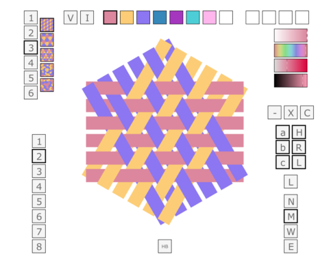

# MadWeave

**MadWeaver is an interactive triaxial weaving pattern editor by Richard Harris.**
It draws three families of interlacing strips in SVG and lets you explore their
colors, spacing, layers, handedness, and over-and-under structure.

[Project website](https://rharriszzz.github.io/madweave/) ·
[Open the editor](https://rharriszzz.github.io/madweave/editor.html) ·
[User guide](https://rharriszzz.github.io/madweave/guide.html)



## Run locally

The application is plain HTML, JavaScript, and SVG. It needs no package install,
server-side application, account, or browser plug-in. Serve the checkout over HTTP
so the editor, project saving, and artwork export can share the same origin:

```sh
python3 -m http.server 8000 --bind 127.0.0.1
```

Open <http://127.0.0.1:8000/> for the website or
<http://127.0.0.1:8000/editor.html> for the editor. Opening HTML directly with
`file://` can prevent the wrapper from accessing the embedded SVG.

## Make a weave

1. Choose one of the five pattern previews on the left.
2. Set the pattern color count with the left-hand **1–6** buttons.
3. Select one of the eight palette swatches along the top, then click a strip.
4. Adjust opacity, hue, saturation, and value with the upper-right sliders.
5. Explore the **a/b/c** layers, **H/R/L** directions, **−/X/C** orientation
   controls, and **N/M/W/E** spacing. Lower-left **1–8** selects 3–24 strips
   per direction. Hover over a control for its description.
6. Choose **Save Project** to download `madweave-project.html`. It includes your
   design, the editor, and all pattern images. Open that file in a browser to
   continue editing offline, or use **Open Project** on the website.
7. Choose **Export artwork as SVG** when you want a static vector image without
   controls or scripts.

Save again after editing: each save downloads a new copy, and your browser may
add a number to the filename. Rename copies to keep different designs. **Open
Project** also accepts original editable MadWeave SVG files; it cannot restore
editing information removed by static artwork export.

Project saving preserves strip colors and visibility, the complete palette and
opacity, recent colors, size, pattern settings, spacing, orientation, visible
layers/directions, paint/hide/show mode, and whether controls are hidden.

Pattern and color-count changes reset manual strip edits; changing the strip
count also resets them. Save a project before those changes if you want to keep
the previous design. There is no full undo or autosave.

The browser checks cover Chromium and Firefox, with WebKit in CI. The original
SVG controls expect a mouse or trackpad; complete keyboard and touch operation
are not yet implemented. The website adapts to smaller screens and lets the
editor scroll horizontally. See [the testing record](docs/TESTING.md) for the
exact browser coverage, and [Mac testing results](docs/MAC_TESTING.md) for
installed Safari, Chrome, and Firefox checks.

## Corner mode on this branch

Use **Design mode → Corner** in the same editor. Choose a supported hole phase,
reference angle and circular crop, then **Apply together**. The same eight-slot
palette, opacity sliders, strip painting and file actions work in both modes.
Clicking paints a complete joined strip; optional inspection exposes hidden
positions and seam partners. Pink markers warn about color changes at seams
without rejecting the edit.

The finite catalogue has 84 certified constructions (60°–720°); it is not the
final allowed-angle list. Unsupported geometry stays explicitly Unvalidated.
Both designs survive mode switching in the session; **Save includes only the
active design**. Saved files reopen, edit, resave and export offline. Existing
planar files and Stage 3A/3B corner files open through the shared action.
Corner SVG is diagram artwork: **physical constructibility remains unverified**.
See [the integration report](research/SINGLE_CORNER_INTEGRATION.md) for evidence,
worked files, keyboard operations, unsupported controls and reproduction.
This branch is awaiting review; no master merge or deployment is included.

## Documentation

- [Planar weaving research](research/README.md): complete control reference,
  hexweave/madweave model, reproducible research suite, and preparation for cone work.
- [User guide](guide.html): project saving, controls, artwork export, and limitations.
- [Architecture and development](docs/DEVELOPMENT.md): rendering, saved state,
  source map, local checks, and GitHub Pages publishing.
- [Testing record](docs/TESTING.md): checks, regression evidence, and coverage limits.
- [Possible improvements](IMPROVEMENTS.md): prioritized follow-up work.
- [Original 2012 project notes](MadWeaver.html) and
  [handbook notes](HandbookOfTriaxialWeaves.html): historical context.

## Test and build

Node.js 24+ runs the dependency-free color/indexing checks. Python 3.10+ runs the
site build and tests. Browser tests additionally require Playwright and the browser under test:

```sh
python3 -m venv .venv
.venv/bin/python -m pip install -r requirements-dev.txt
.venv/bin/python -m playwright install chromium firefox webkit
node --check madweave.js
node --check project.js
node --check editor.js
node --test tests/math.test.cjs
.venv/bin/python -m unittest discover -s tests -v
python3 scripts/build_site.py
```

On Windows, use `.venv\Scripts\python` in place of `.venv/bin/python`. On a fresh
Linux system, Playwright may require `python -m playwright install --with-deps
chromium`. Set `MADWEAVE_BROWSER=firefox` or `MADWEAVE_BROWSER=webkit` to run the same
suite in those engines (the default is Chromium). The site-only checks have no
third-party dependencies:

```sh
python3 -m unittest discover -s tests -p test_site.py -v
```

The build creates `dist/` from an explicit list of public files. It does not copy
Git metadata, tests, local environments, or the whole checkout. Preview that
artifact with `python3 -m http.server 8000 --directory dist --bind 127.0.0.1`.

## GitHub Pages

[The Pages workflow](.github/workflows/pages.yml) tests the real editor and
builds the static site. Pushes to `master` publish `dist/`; pull requests run the
checks without deploying. The repository's **Settings → Pages → Source** must
be **GitHub Actions**. See [deployment notes](docs/DEVELOPMENT.md#publishing)
for setup and verification.

## Keeping browser-test dependencies installed

For a setup that survives `/tmp` cleanup and reboots, follow
[Persistent browser-test setup](docs/BROWSER_TEST_SETUP.md). It covers Ubuntu/WSL
system packages, a project virtual environment, durable browser storage, and
commands for all three test engines.

## History and rights

The original program carries “copyright 2004–2012, Richard Harris, all rights
reserved.” This repository does not currently grant an open-source license;
public source availability alone is not a license to redistribute or modify it.
No new license has been assumed in this update.

The original README linked to
<http://fiberwoman.com/madweave/MadWeaver.html>. That address is retained as
historical provenance; its current availability is not established here. The
legacy HTML, SVG experiments, images, and Batik conversion scripts remain in
the repository. Old browser/plugin download instructions and the scripts'
hard-coded `/Users/rharris/Downloads/batik-1.7/` path are historical, not current
requirements for running the web editor.
