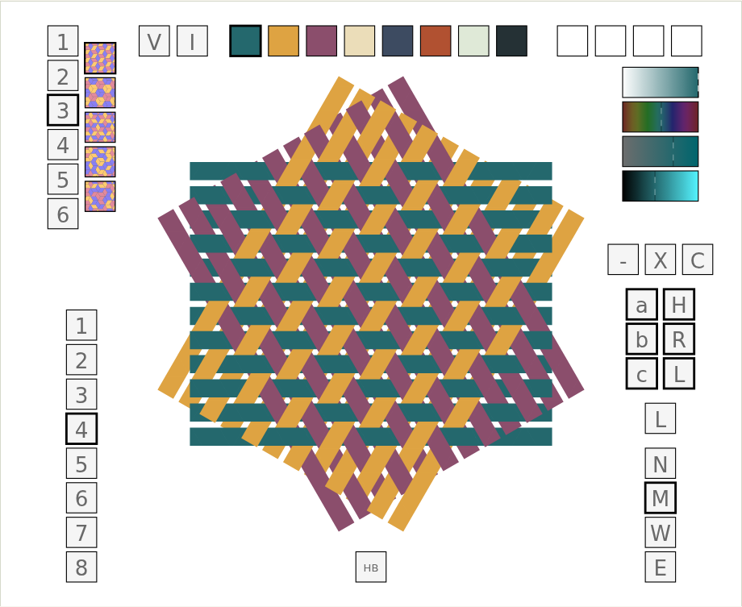
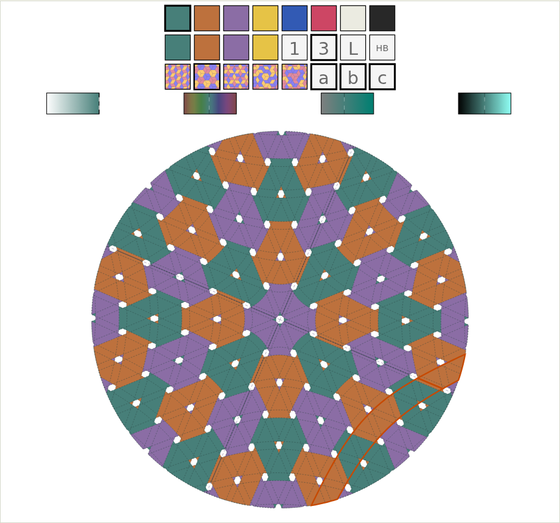
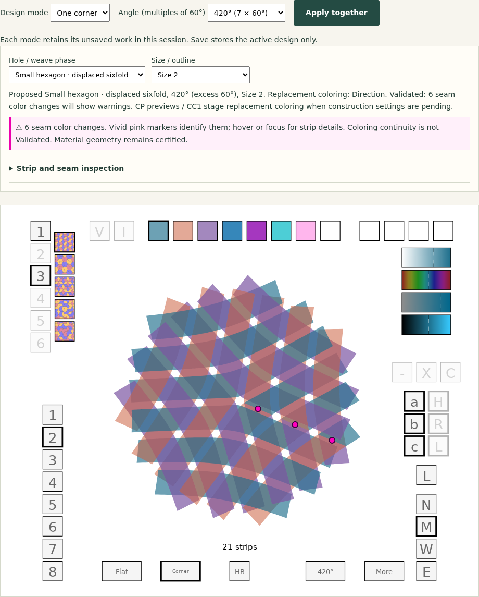

# MadWeave

**MadWeaver is an interactive triaxial weaving pattern editor by Richard Harris.**
It draws three families of interlacing strips in SVG and supports editing their
colors, spacing, visibility, handedness, and over-and-under structure.

[Project website](https://rharriszzz.github.io/madweave/) ·
[Open the editor](https://rharriszzz.github.io/madweave/editor.html) ·
[User guide](https://rharriszzz.github.io/madweave/guide.html)

Switch between planar patterns and a bounded corner-diagram editor. Both use
editable SVG, an eight-color palette, strip painting, and portable project files.

## Editor screenshots

Screenshots below come from the built editor. Click an image for full size.


*Planar direction coloring: twelve strips per direction, with all editing controls visible.*


*A different formula, wider spacing, and a hidden b class reveal the layered structure.*


*A 480° reference-angle corner diagram with class coloring and a full fringe crop.*


*Inspection follows one joined strip through visible and hidden positions; orange marks its material identity.*


*Transparency shows overlapping material. Pink markers deliberately flag a formula's color changes across seams.*

[Capture script](scripts/capture_readme.cjs) · [Screenshot reproduction](docs/SCREENSHOTS.md)

## Run locally

The application is plain HTML, JavaScript, and SVG. It needs no package install,
server-side application, account, or browser plug-in. Serve the checkout over HTTP
so the editor, project saving, and artwork export can share the same origin:

```sh
python3 -m http.server 8000 --bind 127.0.0.1
```

Open <http://127.0.0.1:8000/> for the website or
<http://127.0.0.1:8000/editor.html> for the editor. Opening HTML directly with
`file://` can prevent the wrapper from accessing the embedded SVG.

## Planar mode

Choose **Design mode → Planar**. The five previews select pattern formulas;
**1–6** sets the formula's color count. Choose one of eight top palette swatches
and click a strip to paint it. The sliders change opacity, hue, saturation, and
value; recent colors sit beside the palette.

Planar controls include **a/b/c** hexweave classes, **H/R/L** directions,
**−/X/C** handedness/order/center choices, **N/M/W/E** spacing, outlines, and
individual hide/show modes. Lower-left **1–8** selects 3–24 strips per direction.
Hover over controls for descriptions. Pattern/color-count changes replace manual
strip edits; changing the strip count resets them too.

## Corner mode

Choose **Design mode → Corner**, select a hole/weave phase, reference angle and
circular crop, then choose **Apply together**. Pending settings do not change the
active drawing or saved file. Construction changes replace custom painting and
selection, as described in the proposal.

Use the shared palette and opacity sliders, then click material to paint its
**entire joined strip**, including hidden pieces and seam partners. The five
pattern previews select three-label formulas; **1** selects monochrome and **3**
selects a formula. Formula choices intentionally replace custom painting.
An unchanged **Apply together** preserves painting added after the last formula
choice. With construction changes pending, formula choices are staged for Apply.

Open **Strip and seam inspection** to choose joined strips or crossings, cycle
through local positions (including hidden positions at a self-crossing), and
show dashed hidden pieces or seam partners. **Paint selected strip** supports
painting from that selection. Pink markers mean colors or opacity differ across
a seam: your colors remain, but color continuity is not validated. Transparent
material remains present in the model.

Corner mode uses a **finite catalogue of 84 constructions**, with reference
angles from 60° to 720°. It is not a complete list of possible constructions.
Unsupported configurations remain Unvalidated; rejected construction choices
retain the active design. Independent planar size, spacing, handedness/order,
center, direction filtering, and material hide/show controls are unavailable.
The **a/b/c** buttons instead stage supported hexweave phases.

These are checked **diagrams**, not fabrication templates. **Physical
constructibility remains unverified**: diagram certificates do not establish
that an object can be woven from physical stock. See the
[integration report](research/SINGLE_CORNER_INTEGRATION.md) for the catalogue,
checks, unsupported cases and remaining research scope.

## Save, reopen and export

- **Mode switching retains both designs in the current session. Saving persists
  only the active design.** Save each mode separately before closing the tab.
- **Save Project** downloads a self-contained editable HTML file. Open that
  file directly in a browser to edit and resave offline, or use **Open Project**
  on the website. Saving downloads a new copy; it does not overwrite earlier
  copies. Rename files to keep versions.
- **Open Project** accepts planar projects, original editable MadWeave SVG files,
  and earlier Stage 3A/3B corner projects. A valid import replaces that mode's
  design and retains the other mode; save your work first.
- **Export artwork as SVG** downloads static vector artwork without editor
  controls or scripts. It cannot restore an editable project. Corner exports
  optionally include inspection/warning markers; their caption retains warning
  counts and the physical-constructibility limitation.

Projects preserve the active design's supported settings, palette, opacity,
painting and selection. There is **no full undo or autosave**. Save before
formula or construction changes if you want to retain the previous design.

A mouse or trackpad works best. Corner palette buttons support Enter/Space,
sliders support arrow keys, and inspection has keyboard controls. Complete
planar keyboard and physical touch-device operation remain unimplemented or
unverified. Planar controls scroll horizontally on narrow screens; corner
controls rearrange. Automated checks cover Chromium, Firefox and Playwright
WebKit; WebKit automation is not installed Safari verification. See the
[testing record](docs/TESTING.md) and [Mac testing results](docs/MAC_TESTING.md).

## Documentation

- [Planar weaving research](research/README.md): complete control reference,
  hexweave/madweave model, reproducible research suite, and preparation for cone work.
- [User guide](guide.html): project saving, controls, artwork export, and limitations.
- [Architecture and development](docs/DEVELOPMENT.md): rendering, saved state,
  source map, local checks, and GitHub Pages publishing.
- [Testing record](docs/TESTING.md): checks, regression evidence, and coverage limits.
- [Possible improvements](IMPROVEMENTS.md): prioritized follow-up work.
- [Original 2012 project notes](MadWeaver.html) and
  [handbook notes](HandbookOfTriaxialWeaves.html): historical context.

## Test and build

Node.js 24+ and Python 3.10+ run the development checks. Browser dependencies
are pinned in `package-lock.json` and `requirements-dev.txt`; the application
itself needs no package install:

```sh
python3 -m venv .venv
.venv/bin/python -m pip install -r requirements-dev.txt
npm ci
.venv/bin/python -m playwright install chromium firefox webkit
node --check madweave.js
node --check project.js
node --check editor.js
node --check corner-editor.js
node --check corner-model.mjs
node --check corner-runtime.js
node --test tests/math.test.cjs
.venv/bin/python -m unittest discover -s tests -v
python3 scripts/build_site.py
npm run test:corner
npm run test:corner:browser
```

On Windows, use `.venv\Scripts\python` in place of `.venv/bin/python`. On a fresh
Linux system, Playwright may require `python -m playwright install --with-deps
chromium`. Set `MADWEAVE_BROWSER=firefox` or `MADWEAVE_BROWSER=webkit` to run the same
Python suite in those engines (the default is Chromium). The corner browser
suite runs all three by default; `MADWEAVE_STAGE2_BROWSERS=firefox` selects one.
See [developer setup](docs/BROWSER_TEST_SETUP.md) for browser storage and
[testing](docs/TESTING.md) for generated-asset consistency checks. The site-only checks have no
third-party dependencies:

```sh
python3 -m unittest discover -s tests -p test_site.py -v
```

The build creates `dist/` from an explicit list of public files. It does not copy
Git metadata, tests, local environments, or the whole checkout. Preview that
artifact with `python3 -m http.server 8000 --directory dist --bind 127.0.0.1`.

## GitHub Pages

[The Pages workflow](.github/workflows/pages.yml) tests the real editor and
builds the static site. Pushes to `master` publish `dist/`; pull requests run the
checks without deploying. The repository's **Settings → Pages → Source** must
be **GitHub Actions**. See [deployment notes](docs/DEVELOPMENT.md#publishing)
for setup and verification.

## Keeping browser-test dependencies installed

For a setup that survives `/tmp` cleanup and reboots, follow
[Persistent browser-test setup](docs/BROWSER_TEST_SETUP.md). It covers Ubuntu/WSL
system packages, a project virtual environment, durable browser storage, and
commands for all three test engines.

## History and rights

The original program carries “copyright 2004–2012, Richard Harris, all rights
reserved.” This repository does not currently grant an open-source license;
public source availability alone is not a license to redistribute or modify it.
No new license has been assumed in this update.

The original README linked to
<http://fiberwoman.com/madweave/MadWeaver.html>. That address is retained as
historical provenance; its current availability is not established here. The
legacy HTML, SVG experiments, images, and Batik conversion scripts remain in
the repository. Old browser/plugin download instructions and the scripts'
hard-coded `/Users/rharris/Downloads/batik-1.7/` path are historical, not current
requirements for running the web editor.
