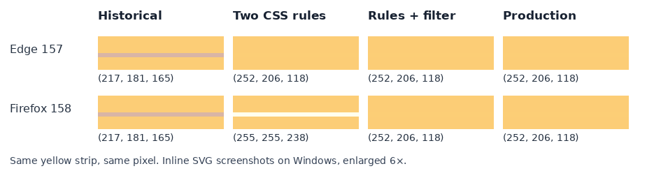

# SVG clip seams in Microsoft Edge and Mozilla Firefox

**Both browsers need a correction for the historical artwork. Edge accepts the two CSS declarations that worked in Chrome. Firefox also needs the identity filter.** In the tested Windows builds, this shared stylesheet matched the current production renderer at every sampled RGBA pixel. It goes inside the SVG so that it travels with the artwork.

```css
#strips { isolation: isolate }
#strips > g[clip-path] {
  mix-blend-mode: plus-lighter;
  filter: opacity(1);
}
```

The filter leaves material opacity unchanged and makes Firefox finish painting each local stack before clipping it. Additive blending then combines the adjoining clips' coverage. The current MadWeave renderer already applies all three declarations and also isolates an inner group for WebKit. The existing cross-browser implementation remains the appropriate default for shared exports. [Production fix and earlier WebKit tests](SVG_SEAM_FIX.md) · [Chrome and Squiggle comparison](SQUIGGLE_AND_CHROME_CLIP_SEAMS.md)

## What appeared on screen

On November 18, 2026, the installed Windows **Microsoft Edge 157.0.4341.46** and **Mozilla Firefox 158.0.1** executables ran headlessly with temporary profiles at device scale factor 1. Both opened the actual historical editor from `286c94e` and the production editor from `51e3a03`. The size-2 and spacing-1 controls rebuilt the weave. The sampled yellow strip should be **(252, 205, 118)** across the shared boundary.

| Browser | Pre-fix | Two declarations | Add the filter | Current production |
|---|---|---|---|---|
| Edge | 217, 181, 165 | 252, 206, 118 | 252, 206, 118 | 252, 206, 118 |
| Firefox | 217, 181, 165 | **255, 255, 238** | 252, 206, 118 | 252, 206, 118 |

These are RGB values from live editor screenshots. A separate 241 × 241 script-free export produced the same values at (224, 120) both inline and in an ordinary SVG image. The adjacent yellow pixels in the live editors had the intended color. [Historical SVG](evidence/pre-fix-clip-weave.svg) · [Two-declaration SVG](evidence/chrome-two-rule-weave.svg)



Transparency distinguished a genuine correction from a close-looking opaque pixel. In the reduced fixture, two 60%-opaque paints should produce alpha 214 on a transparent canvas. Both browsers originally gave 193. Edge gave 214 with the two declarations. Firefox gave **255** with two and **214** once the filter was added. The separate hard-mask experiment also had a portability cost. It chose a single color at a genuine diagonal color transition in Firefox, and in Edge its opaque yellow weave pixel had alpha **192** on canvas despite looking correct inline. [RGBA measurements](evidence/edge-firefox-clip-measurements.json)

## Results across 163 editor configurations

The existing finite-strip geometry test captured the artwork and expected seam colors for 163 editor configurations, including different sizes, spacings, orientations, translucent colors, hidden strips and outlines. Both Windows browsers decoded those same SVGs as images and drew them to fresh transparent canvases. Each method used 90,350 observations at constant-color seams. Errors below compare RGB composited over white with the independent expected color. The project's tolerance is four 8-bit channel levels.

| Browser and method | Worst channel error | Observations over four | Configurations over four |
|---|---:|---:|---:|
| Edge, pre-fix | 35.13 | 7,803 | 163 |
| Edge, two declarations | 7.00 | 472 | 132 |
| Edge, declarations plus filter | 7.00 | 472 | 132 |
| Edge, production | 7.00 | 472 | 132 |
| Firefox, pre-fix | 34.92 | 7,748 | 163 |
| Firefox, two declarations | 109.00 | 7,334 | 163 |
| Firefox, declarations plus filter | 2.55 | 0 | 0 |
| Firefox, production | 2.55 | 0 | 0 |

In Edge both shorter forms matched production in all four RGBA channels at all 90,350 observations. In Firefox the filtered form matched production everywhere tested. The unfiltered two-declaration form differed from production at 7,386 observations. The broad sweep measures SVG image-to-canvas rendering. The historical seam and the Edge exception below were also checked in ordinary display.

## Why a smaller error remains in Edge

Edge's strongest residual also appears in a regular inline SVG and in an image. In the [1198 × 826 witness SVG](evidence/edge-clip-overcoverage.svg), pixel **(955, 620)** inside a purple strip should be **(140, 118, 241)**. Production gave **(144, 121, 248)**. The neighboring pixel at (955, 619) was exactly the intended purple.

Rendering each clipped group in isolation showed where the excess comes from. At that pixel `RLHG` already supplied full coverage, alpha **255**. The adjoining `LHRG` also contributed alpha **7**. Its premultiplied RGB contribution rounded to **(4, 3, 7)**, exactly the excess in the final pixel. The third group contributed zero. The separate paints account for the entire error at this witness. Locating the responsible rasterizer code or extending that explanation to other pixels would require further traces.

Repeating with the **same Edge executable** and `--disable-gpu` changed the adjacent group's alpha from 7 to 0. The entire production matrix then stayed within tolerance, with maximum error **3.14**. Firefox also gave that group alpha 0 under its default test settings. The switch was a diagnostic control. The shared SVG fix works at ordinary browser settings for the original strong seam. The remaining Edge error is a separate target if closer pixel agreement is needed.

## Reproducing the checks

The first command generates a self-contained page for the live comparison of inline SVG, SVG images and transparent canvas readback. Open it at 100% zoom in each browser.

```sh
node research/chrome-clip-alternatives.cjs --write-browser-test /tmp/madweave-browser-comparison.html
```

To generate the full portable matrix, install the [project's research browser dependencies](TESTING.md), serve the repository at `http://127.0.0.1:8766`, and run the command below. It first validates the production scene geometry, then writes a self-contained HTML file. Open that file in each target browser to replay the same artwork and probes. Its JSON gives error counts, the worst witness per method, and differences from production. The generated files can be moved between operating systems.

```sh
MADWEAVE_SEAM_MATRIX_HTML=/tmp/madweave-seam-matrix.html node research/seam-fix-check.cjs
```
