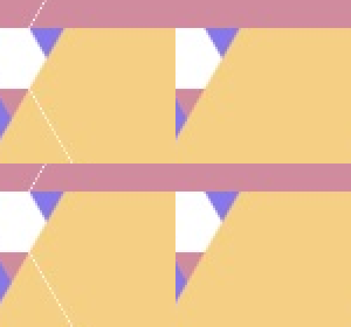

# A smooth SVG mask for Safari’s planar weave seams

Safari 27.2 on macOS 27.2.1 (26B131) showed a pale diagonal across an uninterrupted yellow strip in the published Flat editor. It also appeared when Safari reopened its own size-2, medium-spacing artwork download. The shared editor and its reopened SVG now show continuous yellow in both views. Its maximum channel error across 90,350 Safari canvas samples was 2.40, within the four-level tolerance. The pre-fix measurements and starter colors came from `522cbf1692c012715e8a3f304f84cb716b2bdd64`. [Open the Safari export](evidence/safari-underpaint-weave.svg) · [Measurements](evidence/safari-clip-measurements.json)



## What the controls establish

At the pre-fix revision, production exceeded tolerance at 4,365 samples across all 163 configurations. At its worst pixel, (955, 204) in the opaque size-1, narrow-spacing, C-orientation case, Safari returned RGBA (255, 219, 109, 7) for an expected opaque yellow (252, 205, 118). The low alpha explains why the pixel looks pale on white. The historical renderer failed at 12,521 samples. One 241-pixel historical export probe looked correct with production, which makes the full matrix and the actual-size display important here. These readbacks locate the loss of coverage. Identifying the responsible WebKit or graphics backend code would require a separate trace.

| Safari representation | Samples over four | Maximum error |
|---|---:|---:|
| Pre-fix production clips | 4,365 | 132.99 |
| Independent crisp masks | 10,060 | 31.00 |
| Ordered smooth masks on a single default background | 7,165 | 31.00 |
| Ordered crisp masks | 0 | 2.20 |
| Ordered smooth masks with an underpaint | 0 | 2.40 |

All rows used the same 163 captured scenes and independent strip-color expectations. A pair of 60%-opaque paints in the reduced fixture produced alpha 214 with both passing candidates. At a genuine half-yellow, half-purple edge, the crisp candidate chose pure purple (140, 118, 241). Production and the smooth candidate both gave (196, 161, 180). This second fixture distinguishes the two candidates despite their equally clean constant-color seams. [Reduced fixture generator](chrome-clip-alternatives.cjs)

## How the editor draws the masks

Each original stacking order gets a luminance mask. All masks paint the same region paths in the same order. In each mask its own region is white and the other regions are black. The first stack supplies the default background. Using only that background lets the default order contribute at an antialiased boundary between two *other* orders.

The editor first paints the map in reverse priority, extending each shape with a three-pixel, non-scaling stroke. It then paints the original boundaries in forward priority with ordinary antialiasing. At a boundary between two regions, the second pass blends over the neighboring order already underneath. The stroke exists only inside the coverage map. Each material stack still uses the original finite strip paths, colors, opacity and local drawing order. The isolated weave combines the masked stack contributions with additive blending. [Editor implementation](../madweave.js) · [Experimental variants](ordered-strip-masks.cjs)

## Mac browser comparisons

Each row covers 90,350 samples from SVG images drawn onto transparent canvases. Errors compare RGB over white against the same model. Safari used the installed application. The other rows used headless executables on the same Mac.

| Browser | Pre-fix samples over four | Smooth candidate samples over four | Candidate maximum error |
|---|---:|---:|---:|
| Installed Safari 27.2 | 4,365 | 0 | 2.40 |
| Mac Playwright WebKit 26.6 | 4,365 | 0 | 2.40 |
| Playwright Chromium 153.0.8010.12 | 0 | 0 | 1.44 |
| Playwright Firefox 155.0 | 0 | 0 | 1.73 |
| Installed Google Chrome 157.0.8103.79 | 0 | 0 | 1.50 |

In the separate live-editor regression, Chromium and Mac Playwright WebKit passed all 163 configurations with maximum errors of 1.40 and 3.00. Their size-2, medium-spacing SVG downloads both had zero error at the export probes. The Chromium finite-boundary regression on the local prototype passed all 3,608 pairs, including 384 finite ends. For half-opaque black partitions at four output sizes, two offsets and two rotations, the smooth candidate’s alpha ranged from 127 to 129. Production ranged from 123 to 132 and exceeded the four-level tolerance at 41 pixels.

## Batik export fallback

The mask-only prototype passed the Safari tests but introduced a seam in Batik 1.7. In a 241 × 241 raster at pixel (224, 120), the production export gave the intended opaque yellow, RGBA (252, 205, 118, 255). The mask-only version gave (250, 205, 120, 96). The alpha loss was concentrated on the shared boundary. Reading the adjacent rows alone would have missed it.

The portable export keeps the original `clip-path` attributes on each ordered stack. An embedded CSS feature query switches to the smooth masks in viewers that recognize the required operations. The portable version also passed all 90,350 installed Safari samples, with a maximum error of 2.40. Batik can draw using the original clips. In the prototype check, the entire 241 × 241 raster of the portable export matched the production raster byte for byte after decoding both to RGBA. To repeat the check, use the same historical viewBox (`-1.33 -1.33 2.66 2.66`) and output size for both files. [Integrated SVG export](evidence/safari-underpaint-weave.svg)

## Replay memory

The expanded comparison triggered Safari’s significant-memory reload. At 1198 × 826, each four-channel pixel buffer holds about 3.8 MiB. The previous page decoded all scenes together and created a fresh image, canvas and full pixel readback for every method. Only the production readback needs to survive until the end of each scene. Safari reloaded the page to reclaim memory. A large temporary allocation and a leak can both produce high memory use. This run recorded the warning but no heap or process-memory profile. If it recurs during ordinary editing, record the exact edit sequence in a fresh editor tab and repeat it with Web Inspector’s Memory and JavaScript Allocations timelines. Compare memory after each cycle settles and inspect references to objects that persist across cycles. Record separately whether growth is in the JavaScript heap, decoded images or graphics layers.

A separate Chromium 153 test exercised ordinary editing with the matrix closed. After two warm-up cycles from size 2 to 8 and back, it repeated the same controls 50 times. At every ten-cycle checkpoint after garbage collection, the editor contained 573 active SVG elements. Chromium reported two documents, 1,959 DOM nodes and 237 event listeners throughout. The measured JavaScript heap went from 11.78 to 12.06 MiB. These measurements show no accumulating nodes or listeners for this sequence. Safari process memory and graphics allocations remain unmeasured. [Checkpoint measurements](evidence/safari-clip-measurements.json)

The portable replay now decodes four scenes at a time, clears each canvas after sampling and checkpoints the accumulated counts and worst pixels in session storage. A fresh document starts the next batch. On this Mac the completed Safari production and historical rows reproduced the earlier measurements. The counts describe the full run. No sample or tolerance was dropped. [Replay source](seam-image-matrix.cjs) · [WebKit memory profiling](https://webkit.org/blog/6425/memory-debugging-with-web-inspector/)

## Integrated editor, SVG and PDF

The starter SVG, redraws and restored editable SVGs reuse the three existing region paths in their masks. At size 2 and medium spacing, the Safari download grew from 16,703 to 19,627 bytes. The early prototype that copied the paths took 43,583 bytes.

Installed Safari passed all 163 configurations and 90,350 samples with the integrated renderer. Its maximum error was 2.40 and the historical control still failed at 12,521 samples. The live-editor runs in Chromium, Firefox and WebKit each passed the same sample count, with maximum errors of 1.40, 1.40 and 3.00 respectively. Each engine also reopened its export with zero error at the export probes. The image above shows the installed Safari editor and its real download. [Measurements](evidence/safari-clip-measurements.json)

Printing exposed a separate problem. Chromium displayed the artwork correctly on screen but printed purple at the known yellow seam. Applying an identity opacity filter to the isolated weave group keeps the entire blend together in the print output. With the integrated Safari export at the historical 241 × 241 viewport, Batik 1.7 returned RGBA (252, 205, 118, 255) at (224, 120). The Chromium PDF, rasterized and converted from its embedded Display P3 profile to sRGB, returned (251, 205, 118, 255). Check the seam itself and both adjacent rows when changing the stylesheet.

## Windows verification

The installed Windows browsers tested the integrated masks at `d7d0740` in headless mode with default graphics settings. Each browser replayed 163 editor configurations and compared 90,350 samples with the expected strip colors. The tolerance was four levels per RGB channel.

| Browser | Historical samples over four | Production samples over four | Maximum production error |
|---|---:|---:|---:|
| Chrome 157.0.8103.40 | 7,803 | 0 | 1.27 |
| Edge 157.0.4341.46 | 7,803 | 0 | 1.27 |
| Firefox 158.0.1 | 7,748 | 0 | 1.73 |

In the size-2, medium-spacing live editor, all three browsers showed the intended yellow (252, 205, 118) at the seam and on both adjacent rows. Edge had 472 samples outside tolerance with the earlier clip workaround and zero with the integrated masks. This completes the Windows desktop comparison. [Windows measurements](evidence/windows-seam-replay-d7d0740.json) · [Earlier Edge results](EDGE_FIREFOX_CLIP_SEAMS.md)

## Reproduce

1. Generate the matrix and inspect the native Safari editor and actual download using the [Mac test procedure](../docs/MAC_SAFARI_SEAM_CHECK.md). Set `MADWEAVE_SEAM_COMPARE_MASKS=1` to include the experimental variants. The portable page displays the complete results at 163 / 163.
2. Serve the checkout on port 8766 and run `node research/seam-fix-check.cjs` for the live editor, export and historical control. Choose an engine with `MADWEAVE_RESEARCH_BROWSER`. Generate the reduced fixtures with `node research/chrome-clip-alternatives.cjs --write-browser-test test-results/clip-comparison.html`.
3. For Windows, copy the generated portable matrix to the loopback server. Install Selenium in a test environment and run the following command for each installed browser, replacing `edge` with `firefox` for the second run. Each JSON report records the browser version, failure counts and worst pixel. [Previous Windows measurements](EDGE_FIREFOX_CLIP_SEAMS.md)

   ```sh
   python scripts/test_seam_replay.py edge http://127.0.0.1:8766/matrix.html edge-results.json
   ```
