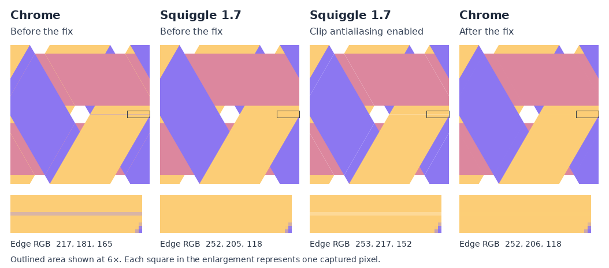
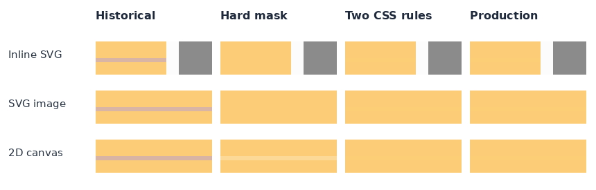

# Why Squiggle avoided the thin lines, and a two-rule fix for Chrome

**For Chrome, the historical MadWeave SVG needs only two CSS rules.** Isolate the weave from the page background and add the coverage of its adjoining clipped groups with `plus-lighter`. The existing triangle coordinates, strip definitions and drawing order can all stay as they are. The [pre-fix artwork](evidence/pre-fix-clip-weave.svg) and the [same artwork with the two rules](evidence/chrome-two-rule-weave.svg) are a pair you can open directly in Chrome.

```css
#strips { isolation: isolate }
#strips > g[clip-path] { mix-blend-mode: plus-lighter }
```

On Linux Chrome for Testing 153.0.8010.12, this passed the same 163 editor configurations and 90,350 seam samples as the production implementation. On installed Windows Google Chrome 157.0.8103.40 it also matched the production fix in the display and transparency probes below. **Keep the existing fix for general-purpose exports for now.** Earlier Firefox and WebKit tests needed additional steps to flatten each local stack. An SVG saved in Chrome may later be opened in either engine. [Earlier three-engine results and rejected simplifications](SVG_SEAM_FIX.md)

The [Windows Edge and Firefox follow-up](EDGE_FIREFOX_CLIP_SEAMS.md) tests this stylesheet in the installed browsers, isolates the extra filter Firefox needs, and measures an Edge coverage error that survives the production fix.

## The renderers behind the browser names

| Desktop browser | Where its SVG rendering comes from |
|---|---|
| Chrome, current Edge and Opera | Chromium's Blink interprets SVG and issues paint operations. Skia rasterizes paths. Blink forked from WebKit. Older Edge used EdgeHTML, Internet Explorer used Trident, and older Opera used Presto. [Blink history](https://new.chromium.org/blink/developer-faq/) · [Chromium graphics](https://www.chromium.org/developers/how-tos/getting-around-the-chrome-source-code/?level=1) · [Microsoft Edge](https://blogs.windows.com/windowsexperience/2016/08/04/edge-anniversary-update/) · [Trident](https://learn.microsoft.com/en-gb/deployedge/edge-ie-mode) · [Opera](https://blogs.opera.com/security/2017/01/legacy-opera-presto-source-code-appearance-online-sharing-sites/) |
| Safari | WebKit's WebCore acquired SVG support in 2005 through a port of KDE's KSVG2 and KCanvas. The graphics backend depends on the WebKit port. [WebKit's original announcement](https://webkit.org/blog/7/webcore-svg/) |
| Firefox | Mozilla's Gecko has its own SVG implementation. Libart was its first substantial SVG backend. Early releases used Cairo. Modern Firefox uses Moz2D for drawing operations and WebRender, originally from Servo, for compositing. [Mozilla's SVG history](https://www-archive.mozilla.org/projects/svg/build) · [Firefox graphics](https://firefox-source-docs.mozilla.org/gfx/index.html) · [WebRender](https://wiki.mozilla.org/Platform/GFX/Quantum_Render) |
| Squiggle | Apache Batik is an independent Java implementation. Contributors included ILOG, Kodak and Sun. Its bridge converts SVG into a Graphics Vector Toolkit tree painted through Java2D. [Project origins](https://www.w3.org/2001/01/qa-ws/pp/thierry-kormann-ilog.htm) · [Batik architecture](https://xmlgraphics.apache.org/batik/using/architecture.html) |

## Reproducing the historical image

One commit changed production painting, [`43f3695`](https://github.com/rharriszzz/madweave/commit/43f3695). The preceding commits `f748915` and `286c94e` diagnosed the repeated alpha blending and added controls. Merge `3a004b1` brought the fix into `master`.

On November 18, 2026, separate Git archives of `286c94e` and `43f3695` were opened in Chrome for Testing. The size-2 and spacing-1 controls rebuilt the weave in each historical editor. In a 1500 × 1100 viewport at device scale 1, with SVG viewBox `-1.33 -1.33 2.66 2.66`, pixel (954, 412) of the live SVG capture changed from **(217, 181, 165)** to **(252, 206, 118)**. The intended strip color is **(252, 205, 118)**.

The historical editor's **Export artwork as SVG** command supplied the artwork for the renderer comparison. A 241 × 241 viewport puts the horizontal edge through the center of row 120. The figure samples (224, 120). Squiggle captures came from the completed render of the viewer's own canvas on Linux with OpenJDK 21.0.13. Squiggle 1.7 is the version linked in the [original MadWeaver guide](https://github.com/rharriszzz/madweave/blob/76a3da0/MadWeaver.html). Its captures and Squiggle 1.18's matched pixel for pixel in all seven Batik cases.



## Why Batik gives a different result

The two triangles in the [reduced SVG](fixtures/clip-seam-minimal.svg) meet exactly. At their diagonal, Chrome paints purple, yellow, purple and yellow, each with about half coverage. Ordinary source-over blending gives **5/8 yellow + 5/16 purple + 1/16 white**. That predicts the observed (217, 181, 165) to the nearest integer. In the tested Chromium source, Blink explicitly sets antialiasing on its path clip and Chromium passes that flag to Skia. The Firefox direct-clip route and the one-group controls are documented in the earlier diagnosis. WebKit's Skia port also requests an antialiased path clip. [Blink 153](https://chromium.googlesource.com/chromium/src/+/refs/tags/153.0.8010.12/third_party/blink/renderer/platform/graphics/compositing/paint_chunks_to_cc_layer.cc#588) · [Chromium paint playback](https://chromium.googlesource.com/chromium/src/+/refs/tags/153.0.8010.12/cc/paint/paint_op.cc#1232) · [Skia's two raster paths](https://skia.googlesource.com/skia/+/9d07e5bad9e3e21da2426946e589daa647218271/src/core/SkRasterClip.cpp#185) · [Firefox and the reduction](SEAM_ROOT_CAUSE.md) · [WebKit graphics source](https://github.com/WebKit/WebKit/blob/main/Source/WebCore/platform/graphics/skia/GraphicsContextSkia.cpp)

In Batik 1.7 and 1.18, `SVGClipPathElementBridge.createClip` initializes `useAA` to false and checks the computed `shape-rendering` on the **clipPath element**. With the default `auto`, `AbstractGraphicsNode.paint` installs a Java2D shape clip. OpenJDK converts a nonrectangular clip to an integer-span region. Rendering the two halves separately showed exactly what that means here. One owned 29,159 pixels and the other 28,441. Their intersection was empty and their union covered all 57,600 pixels. Drawing both produced solid yellow everywhere. Chrome had 239 off-color diagonal pixels. [Apache 1.7 sources](https://archive.apache.org/dist/xmlgraphics/batik/batik-src-1.7.zip) · [Batik 1.18 bridge sources](https://repo.maven.apache.org/maven2/org/apache/xmlgraphics/batik-bridge/1.18/batik-bridge-1.18-sources.jar) · [OpenJDK clip implementation](https://github.com/openjdk/jdk21u/blob/master/src/java.desktop/share/classes/sun/java2d/SunGraphics2D.java#L1900)

Putting `shape-rendering="geometricPrecision"` on each `<clipPath>` made a 239-pixel line appear in **both** Squiggle versions. Batik then renders each stack offscreen and applies a grayscale coverage mask to the completed result. Yellow has already covered purple, so two half-covered yellow groups leave one quarter white. The prediction is (252.75, 217.5, 152.25). Squiggle gave (253, 217, 153) in the fixture and (253, 217, 152) in the weave. [Batik graphics-node sources](https://repo.maven.apache.org/maven2/org/apache/xmlgraphics/batik-gvt/1.18/batik-gvt-1.18-sources.jar) · [Batik mask implementation](https://repo.maven.apache.org/maven2/org/apache/xmlgraphics/batik-awt-util/1.18/batik-awt-util-1.18-sources.jar)

## Which Chrome alternatives worked?

The Linux tests exercised opaque and translucent strips, hidden strips and directions, a hidden hexweave class, outlines, local ordering and the real export command. The table gives the largest absolute 8-bit channel error at constant-color seams against an independent finite-strip model. The existing acceptance tolerance is four levels. Each passing row covered 163 editor configurations and 90,350 samples. [Experiment](chrome-clip-alternatives.cjs) · [Editor matrix](seam-fix-check.cjs)

| SVG representation | Result on Linux Chrome 153 |
|---|---|
| Historical clip paths | The live negative control missed by 47 levels. |
| Add `crispEdges` or `optimizeSpeed` to each clip path | Chrome accepted both computed styles. Both the full weave crop and the reduced fixture were pixel-identical to the originals. |
| Use only `mix-blend-mode: plus-lighter` on the clipped groups | The transparent weave export looked correct at the probe. Adding a white rectangle behind it in the SVG turned the intended yellow pure white. Parent isolation made both versions agree. |
| Replace the clips with white, antialiased SVG masks | The reduced seam became pale yellow (252, 218, 152). With two 60%-opaque paints on transparency, seam alpha was 169 instead of the expected 214. |
| Use white SVG masks with `shape-rendering="crispEdges"` | Passed the Linux matrix, maximum error **1.40**. The opaque export probe was exact. There is a Windows canvas exception below. |
| Use smooth masks plus additive blending | Both luminance and explicit alpha masks exceeded tolerance. At size 1, first spacing, C orientation, the expected (220, 135, 158) became (226, 139, 162). Each run stopped at that failure. |
| Keep the clip paths and add the two CSS rules above | Passed, maximum error **2.78**, opaque export error **2**. |
| Current production grouping, filter and blend | Passed, maximum error **2.78**, opaque export error **2**. |

A second test filled each of the historical weave's three clipping regions with 50%-opaque black. Correct ownership gives alpha 128 everywhere, including where several regions meet. At four output sizes, two subpixel offsets and rotations of 0° and 17°, the hard mask gave exactly 128 at all **1,441,356** Linux pixels. The two-rule and production versions had identical alpha ranges of 123–132. Each had 41 pixels more than four levels from 128, all in rotated cases. The old clips had 15,552 such pixels. The rotation test measures a small residual even with the production fix.

There is a visible tradeoff at a genuine change of color. Where half the diagonal pixel should be yellow and half purple, the hard mask chose pure yellow (252, 205, 118). The two-rule version gave (196, 162, 180), within one level of the area-weighted mix. The hard mask reproduces Batik's sharp pixel ownership. The two-rule version preserves a smooth color transition. [SVG shape-rendering hints](https://www.w3.org/TR/SVG2/painting.html#ShapeRenderingProperty) · [SVG masks](https://www.w3.org/TR/css-masking-1/#MaskElement)

## Installed Windows Chrome exposed a canvas difference

The same script-free 241 × 241 historical weave was displayed inline, displayed as an SVG image, and drawn from that image to a transparent 2D canvas. Both graphics settings used the installed headless Chrome executable and an isolated temporary profile. Screenshots used device scale factor 1. The first two columns below are screenshot RGB on white. The last two columns are canvas RGBA before the browser composites it onto the page.

| Method | Inline SVG | SVG in an image | Canvas, default graphics | Canvas, GPU disabled |
|---|---|---|---|---|
| Historical | 217, 181, 165 | 217, 181, 165 | 214, 175, 158, **240** | 214, 175, 158, **240** |
| Hard mask | 252, 205, 118 | 252, 205, 118 | 251, 205, 117, **192** | 252, 205, 118, **255** |
| Two-rule clip | 252, 206, 118 | 252, 206, 118 | 252, 206, 118, **255** | 252, 206, 118, **255** |
| Production | 252, 206, 118 | 252, 206, 118 | 252, 206, 118, **255** | 252, 206, 118, **255** |



The hard-mask canvas showed a pale (252, 217, 151) line on the white page. With translucent material the same method gave alpha 169 instead of 214. Disabling GPU acceleration eliminated the hard-mask discrepancy on this machine. This narrows the difference to a graphics-dependent path. Identifying the exact backend instruction would require tracing the Windows build. The two CSS rules matched production in the opaque, translucent, genuine color transition and weave probes on both Windows settings. [Measured pixels and matrix summaries](evidence/chrome-clip-measurements.json)

## Implementation and remaining checks

The planar editor now embeds a single stylesheet in its SVG definitions. The
same rules cover the built-in design on first display, older editable SVGs
opened with the current engine, and newly exported artwork. The viewer enables
the rules together using CSS `@supports`. Each region still contains its
ordered paints inside an isolated group for WebKit. The two-rule SVG remains
the smaller Chrome reference. [Production renderer](../madweave.js) · [Edge and Firefox results](EDGE_FIREFOX_CLIP_SEAMS.md)

The production stylesheet passed 163 configurations and 90,350 samples per
engine in Linux Chromium 153, Firefox 155 and WebKit 26.6. The maximum channel
errors were 2.78, 2.40 and 2.78, respectively, against a tolerance of four.
The actual artwork download also passed as an SVG image in all three engines.
With either CSS feature made unavailable, each browser used ordinary group
painting and preserved all three strip directions. All 19 site and editor tests
passed in each engine, including editable HTML save, offline reopen and resave.
The starter SVG, loaded directly as a script-free image at the historical probe
viewBox, changed from (217, 181, 165) to (252, 206, 118) in Chromium.

At the yellow probe (224, 120), Batik 1.18's PNG transcoder rendered the new
241 × 241 export as (252, 205, 118), exactly the intended color. A Chromium
PDF print of that image on a 241 CSS-pixel square page, rasterized by Poppler at
96 dpi, gave (251, 204, 118) both on the seam and immediately above and below.
The historical image through the same print path gave (223, 185, 155) on the
seam and (252, 205, 118) on the adjacent rows. This checks one PDF pipeline.

The remaining measurement targets are the small Edge overcoverage and rotated
clips described above. An installed Safari check of this particular stylesheet
would supplement the WebKit sweep and the earlier native Safari editor tests.

## Repeat the Chrome experiments

With the repository's Node dependencies and Playwright Chromium installed, run the first command for the reduced fixtures and the partition sweep. The second produces a self-contained HTML file for opening in an installed browser. Its three rows show inline SVG, an SVG image, and the visible canvas. RGBA values below the rows are canvas readbacks.

```sh
node research/chrome-clip-alternatives.cjs
node research/chrome-clip-alternatives.cjs --write-browser-test /tmp/madweave-clip-comparison.html
```

For the editor matrix, serve the repository on loopback port 8766 and run the following from its root. `MADWEAVE_CHROMIUM_EXECUTABLE` can select a specific build. `MADWEAVE_SEAM_VARIANT` also accepts `hard-mask`, `additive-mask` and `additive-alpha-mask`. Omitting the variable runs the production baseline.

```sh
MADWEAVE_SEAM_VARIANT=additive-clip node research/seam-fix-check.cjs
```
