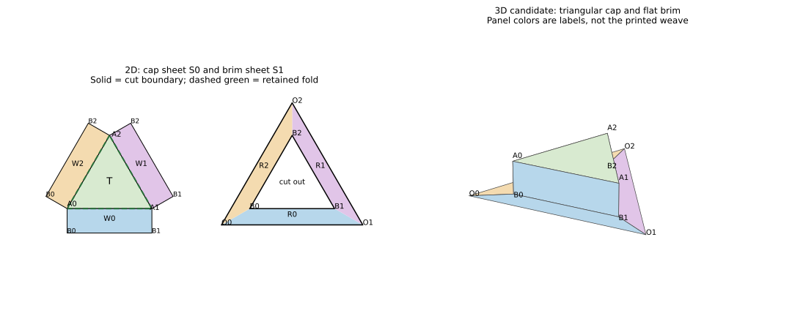

# Net and 3D construction: design advice

Work on `research/multicorner-3d-explorer`, following
[the advisory prompt](ASTRA_DESIGN_PROMPT.md). This is a construction proposal,
with an arithmetic check and an explanatory diagram, not an application or a
POV-Ray implementation. Richard accepted the two-sheet hat candidate during the
review and clarified that the software must support varied shapes, including
polyhedra, through several ways of specifying corners and nets.

## Recommended workflow

Keep two linked views of **one assembled paper surface**: a length-preserving
2D paper layout and a 3D placement of those same regions. Use POV-Ray for the
first assembled views. Selecting a corner, face, join or printed strip should
identify the corresponding occurrences in both views.

The hat is a first example, not the general data model. Provide three entrances:

1. **Paper first:** start with patterned sheets; choose openings, remove or add
   angle, draw cuts, and pair boundaries. This follows Richard's method.
2. **Faces first:** specify polygonal faces and their edge adjacencies, or a
   particular polyhedron with known face coordinates. Derive vertex angles from
   its incident faces, choose which edges to cut, and unfold retained face groups.
   Pattern placement and corner-opening compatibility are subsequent constraints.
3. **Recipe first:** start with a parameterized construction such as the hat;
   change dimensions or joins, then edit its ordinary pieces and faces.

These entrances should produce the same regions and oriented edge identifications.
The corner list is partly derived: a vertex can be several boundary occurrences
before assembly. It must not be restricted to a list of independently generated
cones. A recipe should expand into inspectable geometry, with its parameters
retained for convenient editing; conflicting free edits should explicitly detach
or update that recipe rather than silently be overwritten.

For polyhedral nets, selecting a tree of retained face adjacencies is a useful
first unfolding method. A tree does not guarantee a layout without overlaps.
Show intersections; allow additional cuts and separate sheets. When the original
3D face coordinates are known, they already provide a pose. When only lengths
and adjacency are specified, the pose may still require fold choices or closure
work. Do not promise a general solver as part of this first example.

## Worked hat: two sheets, six corner sites



The diagram is geometric: panel colors are labels, not a rendering of the weave.
Repeated B labels in the cap net are distinct paper occurrences that tape to the
same assembled site. Solid outlines are cuts. Green dashed lines are folds.
The colored subdivisions R0–R2 of the brim are **not cuts or folds**.

Use an equilateral top T, three rectangular walls W0–W2 and a flat triangular
brim. The cap is one connected sheet S0 (T plus its three attached rectangles).
The brim is a second sheet S1 with a triangular hole. No bottom face closes the
hat. A later rounding of the outer brim can change its outline without changing
the six interior corner angles.

### Dimensions and reference coordinates

Let pitch P be the distance between neighboring parallel strip centerlines.
Use the fixed signed-index convention in [Stage 1](../SINGLE_CORNER_STAGE1.md),
not the size-dependent array indices. One explicit candidate is:

```text
W/P = 3/4; C = hand = X = 0
L = 12 sqrt(3) P       top edge length
H = 6 P               wall height
w = 4 P               perpendicular brim width

A0 = (0,0)
A1 = (L,0)
A2 = (L/2, sqrt(3)L/2)
t_i = (A_(i+1) - A_i)/L           indices modulo 3
o_i = (t_i.y, -t_i.x)            outward unit normal
O_i = A_i + w o_i - sqrt(3) w t_i
```

All coordinates in this section are paper coordinates. Sheet S0 retains T and
rectangles `A_i + u t_i + v o_i`, with `0 <= u <= L`, `0 <= v <= H`.
Its outer boundary and the gaps between the wall rectangles are cut; T/W edges
stay attached. S1 retains the closed region between triangle A and triangle O.
Its inner vertices are labeled B_i in the assembly. The triangles share a center;
the outer side is `L + 2 sqrt(3)w`. R_i is the trapezoid with vertices
`A_i, A_(i+1), O_(i+1), O_i`; these three regions partition S1 completely.

The sheets can be placed independently on the net page at the same scale. Moving
one for page layout must not reset its printed coordinates. Print tiling across
physical pages, if required, is another set of registered joins, not permission
to shrink one piece to fit.

### Sites and angles

Here beta is the total incident **reference paper angle**. Deficit is
`delta = 360° - beta`; a positive deficit removes angle, a negative one adds it.

| Assembled site | Incident reference angles | beta | Net change from a plane |
| --- | --- | ---: | ---: |
| A0, A1, A2: crown | top 60° + wall 90° + wall 90° | 240° each | remove 120° each |
| B0, B1, B2: brim junction | brim 300° + wall 90° + wall 90° | 480° each | insert 120° each |

There are six defect sites. The middle of a fold or a straight taped edge has
360° of incident paper; it is not an additional defect. The outer brim vertices
are boundary vertices, with 60° interior angle, not interior corner sites.
The six interior deficits sum to zero; the three outer boundary turns sum to
360°, as expected for this disk-shaped surface. This angle check alone does not
prove pattern registration, which is checked separately below.

This is also a literal way to see the insertion: at each B corner, cutting the
triangular hole removes 60° from the brim sheet, leaving 300°. The cap supplies
two 90° wall corners, adding 180°. The net addition is 120°. We do not need to
pretend that one separate 120° wedge was pasted into each location.

For the full madweave hole catalogue, define `k_d = normal(d) dot p / P`.
All three k values are integers with sum zero at a small hexagonal opening.
The crown k triples are `(0,0,0)`, `(0,-18,18)`, `(18,-18,0)`.
The B sites in S1 have these same coordinates but different paper identities.
Their occurrences at the bottoms of W_i have the corresponding endpoint k plus:

| Wall | k shift from its top to bottom |
| --- | --- |
| W0 | (-6, 3, 3) |
| W1 | (3, -6, 3) |
| W2 | (3, 3, -6) |

Every occurrence is therefore in an opening, with clearance `(P-W)/2=P/8`.
All these shifts are zero modulo 3. For a hexweave variant with C=0 and class
h=1, these same points are large hexagon centers; that variant preserves its
membership at the proposed joins. The first example uses full madweave.

### Boundary-pairing ledger and assembly

There are six taped edge pairs. Parameter directions below identify matching
points; oriented boundary traversal on the two incident faces must be opposite.
Tape tabs are not included in these reference polygons.

| ID | First boundary | Second boundary | Point correspondence and length |
| --- | --- | --- | --- |
| F_i, i=0,1,2 | T edge A_i A_(i+1) | W_i top | retained paper fold, u maps to u; L |
| J_i, i=0,1,2 | W_(i-1) end at A_i | W_i start at A_i | v maps to v, crown to brim; H |
| K_i, i=0,1,2 | W_i bottom | S1 inner edge B_i B_(i+1) | u maps to u; L |

Build sequence:

1. Print the same scale and registered pattern on S0 and S1. Mark A, B, J and K
   labels in an annotation layer so they can be omitted from the artwork.
2. Cut the cap outline, including the gaps between adjacent wall rectangles.
   Keep all three F edges attached. Cut S1's outer triangle and its inner hole.
3. Fold the three walls down 90° from the top and tape the three J edges.
   This makes an open-bottom triangular cap with three 240° crown corners.
4. Position the cap above the brim hole and tape each K pair. Each wall/brim
   junction is a 90° crease at a tape join. The three B sites now have 480°.
5. Inspect the underside as well as the outside; identify all paired endpoints
   before adding optional tape tabs or rounding the outer boundary.

Printed sheets have paper throughout the white pattern openings. Choosing an
opening for a vertex means avoiding printed strip material there; it does not
cut that opening out of the paper.

### Pattern registration, including an actual strip trace

Choose the class-color formula `color = s mod 3` at C=0, with three palette
colors, for the first hat. This differs from direction coloring. The geometric
construction admits other assignments, but their color continuity must be
checked independently and may produce warnings.

Across F_i the print is continuous on the same sheet. Across J_i, unfolding the
walls into one reference plane gives a 120° rotation about A_i (or its inverse).
Stage 1's exact strip transport is
`(d,s) -> (d+1 mod 3, s+k_(d+1)-k_d)`.
All crown k entries are multiples of 3, so this preserves class color and local
crossing order. It preserves full band widths and both sides, not just spines.

Across K_i the reference map from wall to brim is translation `q -> q-H o_i`.
For shift vector k above, the transported label is `(d,s-k_d)`. Its entries are
multiples of 3, preserving the selected class colors and crossing-order phase.
For example, on W0's lower edge a strip `(1,0)` becomes brim `(1,-3)`.
Both have class 0. Its centerline intersects that edge at `u=11P/sqrt(3)`, which
lies inside this candidate's length L. The whole band interval agrees under the
translation, not merely this point. At J0, the clockwise 120° rotation from W0 to W2 takes `(0,0)` to `(2,0)`;
these labels both have class 0. The exact H strip `(0,0)` crosses the downward
wall-side ray at v=2.5P, inside H=6P. In contrast, direction coloring assigns
these two occurrences different colors and should report a seam-color warning.

The six local maps are symmetries of the same periodic printed field; composing
them around cycles preserves that field. A loop can permute strip labels.
Global strip identities therefore come from the joined full material regions,
not from asserting that a label returns unchanged around every corner. This
proposal establishes printed-pattern registration; it does not enumerate or
certify every resulting individual ribbon, its endpoints or self-crossings.

### Explicit 3D placement and closure

Anchor the brim in z=0 and the crown in z=H, with the same horizontal triangle A.
These are length-preserving panel maps:

```text
T:   q -> (q.x, q.y, H)
W_i: q=A_i+u*t_i+v*o_i -> (A_i.x+u*t_i.x, A_i.y+u*t_i.y, H-v)
S1:  q -> (q.x, q.y, 0)
```

Each wall's basis maps to orthogonal unit vectors, so no reference distance is
stretched. Both sides of J_i map to the segment `(A_i,H-v)`; both sides of K_i
map to `(A_i+u*t_i,0)`. These equalities hold along the entire edges. All three
walls close because A is a closed triangle. The walls lie over its boundary;
the brim lies outside its interior and the top above it, so these ideal panels
have no unintended surface intersections.

The signed fold convention should use outward paper normals: top and brim +z,
walls o_i. Top-to-wall and wall-to-brim turns have opposite signs; their
magnitudes are 90°. Specify those target normals rather than an ambiguous
"dihedral 90" label. The 240°/480° values are intrinsic vertex angles, not these
fold angles and not a cone opening angle.

H is both a rectangle dimension in the net and the height in this right-prism
pose. Changing H while keeping vertical walls is a construction edit. A camera
orbit changes neither net nor pose. An exploratory fold change may create an
open assembly; display the unsatisfied closure rather than stretching panels.

The photograph visibly supports a triangular raised top, walls and an outward
skirt with a triaxial print. This candidate simplifies the skirt to a plane,
the walls to rectangles and the outline to a triangle. The photograph's curled
boundary, possible wall slope, exact dimensions, concealed seam positions and
paper recipe are not recovered. Richard has accepted this as a useful similar
construction, not an exact reconstruction of that object.

## Shared construction model and editing

Keep a small working structure, without standardizing an interchange format yet:

| Record | Information |
| --- | --- |
| Pattern/source | pitch, width, signed phase, membership, C/hand/X, palette/RGBA and assignment |
| Paper piece | stable ID, local reference coordinates, complete regions including holes, source-pattern transform, front/back |
| Panel/crease | regions within a piece, retained edges, explicit crease directions; no mandatory rigid panel at every cut |
| Join | two oriented boundary intervals, endpoint pairing, reference registration map, face/side transport |
| Corner | equivalence class of local vertex occurrences, their opening kinds/phases, derived beta and optional target beta |
| Net layout | separate rigid layout transform and page assignment per piece; print scale |
| Pose | anchor, panel placements/fold targets or a specified curved-surface construction, closure status |
| View | camera, lights, labels and rendering materials |

The geometric authority is the retained regions and joins, not an operation log
or a collection of rendered corner diagrams. Keep operation history for editing
and provenance. In a faces-first model, distinguish an assembled edge from its
manufacturing choice: retained fold or cut-and-tape seam. A crease can be added
within one continuous sheet without creating two physical pieces.

For a paper-first control, recommend **"paper angle at corner: beta"**, with
"remove A" or "insert A" shown alongside it:
`remove A => beta=360°-A`; `insert A => beta=360°+A`.
For faces-first work beta is initially the sum of the incident face angles.
Changing its target is a request to change the surrounding geometry, not an
independent slider that leaves fixed faces untouched. A cube, for example, has
270° at each vertex. That is a valid paper polyhedron but falls outside the
current symmetric 60° weave-join constructions; compatibility cannot be assumed.
Allow a documented printed discontinuity for a paper model if desired, while
keeping a separate failure for a claimed seamlessly registered weave.

After choosing an opening and angle in paper-first mode, the user also chooses
cut rays or a cut path and the join partners. Angle alone does not choose them.
Initially use finite polygonal sheets and straight cuts to an existing boundary,
with explicit added pieces. Later corners may lie on retained or inserted paper.
Select them by piece and local point, not a screen position that could hit several
occurrences. Split affected edges, update joins, recompute corner equivalence and
show conflicts before replacing a valid construction. A deleted region cannot
continue to supply a corner or joined interval. Do not apply independent radial
angular distortions over the whole plane; `f=360°/beta` belongs to the old chart,
not to the metric of a usable net.

For an initial hat interface expose pitch, top side in lattice units, wall height
in compatible units, brim width, pattern/palette, opening markers, join labels,
and camera presets. Add folded/exploded inspection as a viewing mode. A generic
fold editor can follow; the first recipe need not pretend H and all fold angles
are independent parameters. Height edits outside the demonstrated phase family
must rerun registration checks rather than snap silently.

Printed-paper mapping uses local reference coordinates for texture sampling
before applying the 3D placement. Reference lengths determine texture scale.
Choose printed front/blank back first; double-sided printing needs an explicit
back-side convention. Do not accidentally mirror a texture to make a seam fit.
Palette opacity belongs to the printed pattern: transparent ink over opaque paper
reveals the paper, not necessarily the scene behind it. A translucent paper
material is a separate rendering choice. Optional visual thickness must be labeled
as such; robust thick-paper joints and ribbon clearance require further work.

## Reuse and checks

Reuse the original planar geometry, signed strip/class rules, hole catalogue,
phase and rotation maps, local crossing order, palette and selection semantics.
Use the complete-region clipping and join principles from the crop follow-up.
The single-corner kernel's angular chart is not a multi-corner net generator;
its trusted finite certificates do not certify this new topology.

For the printed-paper milestone, check all retained paper, matching edge lengths,
orientation, opening clearance, crease isometries and print registration. For a
later ribbon milestone, intersect **full band regions** with all retained and
inserted pieces, match full-width seam ports, derive components and preserve
local positions. Crossing strips never become joined merely by intersecting.
A self-crossing retains two local positions even if they share a global strip ID.
Visibility and alpha do not delete material. Preserve the current distinction
between warned color conflicts and geometry/order errors.

The accompanying `draw_hat_candidate.py` generated the diagram and checked this
candidate's integer phases, outer edge closure, panel metric and representative
edge dimensions. It exhaustively compared crossing order over representative
index residues for the three rotations/translations, using the existing Stage 1
precedence formula, and checked class-color transport. This is a source-derived
arithmetic check, not an independent weave theory or a fabrication certificate.
Run it with Python, NumPy and Matplotlib; it only regenerates the advice SVG.

Two targeted failure fixtures for implementation:

- Change just one wall height by P/2: its vertical taped edge no longer matches
  its neighbor, and its bottom print translation no longer has the required
  integer phase. Report both with edge/strip witnesses; never stretch to fit.
- Keep geometry and switch class colors to three distinct direction colors:
  J0's `(0,0)`/`(2,0)` pair disagrees. Retain the design with a color warning.
  A geometry rejection here would reinstate the superseded color policy.

Additional acceptance checks should cover every K/J parameterized edge, complete
brim coverage including its hole, consistent front normals, all corner
occurrences and view-independent IDs. Compare an orthographic top render and
side elevations to the exact dimensions, and inspect an underside render. Pixels
support those checks; they do not replace registration or closure calculations.

## POV-Ray organization and first milestones

Keep the first scene small. The following is organizational pseudocode, not
validated scene-language syntax or a prescribed new API:

```text
hat_parameters: P, W, L, H, w, pattern phase, palette
hat_reference: T, W[3], brim ring; named vertices and joins
paper_pattern: planar artwork sampled in each region's reference coordinates
hat_placement: the three explicit maps above
hat_scene: named surfaces, optional seam/vertex labels, camera and lights

PaperPanel(id, reference_polygon, reference_to_pattern, placement)
MarkJoin(id, paired_edges, placement)
CameraPreset("net" | "three-quarter" | "top" | "side" | "underside")
```

Use planar triangles/polygons with explicit reference-coordinate texture mapping;
triangulate the brim around its hole so no triangle fills the opening. Keep
coplanar triangulation edges invisible. The existing planar renderer can supply
a correctly registered image of the print; retain its origin, pixel-to-P scale
and phase, and do not resize each panel's print independently. Texture raster
resolution limits visual detail, while the analytic reference model owns joins.
A continuous printed sheet does not require individual 3D strips or real ribbon
overpasses for this milestone. Plain shaded panels with labels are a useful
first render before applying the verified pattern.

Preserve parameters, reference polygons, join ledger, placement equations,
texture coordinates and IDs so that a later browser port can reproduce them.
Do not depend on recovering that construction intent from arbitrary `.pov` code.
Use the already investigated browser viewer only after the POV-Ray example works.
No new renderer or library comparison is proposed here.

Concrete sequence, each leaving something usable:

1. **Recommended next milestone: the hat recipe in both views.** Generate a
   true-scale labeled net and a POV-Ray scene from the equations above. Render
   plain panels, then the class-colored print. Deliver the six joins, six sites,
   closure/registration checks and five camera views together. This is small
   enough for Richard to compare against a paper build.
2. Expose several selected corner occurrences and beta values on that net;
   allow bounded recipe dimension edits and explain rejected registrations.
   The 2D labels and 3D labels must still point to the same construction records.
3. Add paper-first cuts/insertions and explicit edge pairing over finite sheets,
   starting with this recipe's operations. Keep working examples available.
4. Add a faces-first example, such as a tetrahedron: four equilateral faces,
   three 60° angles per vertex, beta=180°. Choose suitable sixfold opening phases
   and check print joins globally before claiming weave compatibility. Let the
   user change the cut tree and see different nets of the same 3D object.
   This exercises a closed surface and a different authoring path, rather than
   treating every shape as a hat. Its total deficit must be 720°.
5. Port the working geometry and print coordinates to an existing browser viewer;
   retain POV-Ray as the rendering reference. Curved paper and physical ribbons
   can then be separate, motivated extensions.

No production code, project schema or published site changes accompany this
advice. The next milestone is deliberately a concrete POV-Ray construction;
the shared model is broad enough that later polyhedra do not require replacing it.

## Remaining decisions for Richard

The candidate resolves the geometry of a similar hat. The photograph does not
establish the original's exact cuts, print phase, dimensions or bending. The
proposal also challenges three assumptions: a beta does not determine its cuts
or 3D pose; an automatically unfolded net need not fit one sheet without overlaps;
and an arbitrary polyhedron need not preserve a chosen weave at all seams.

Two useful questions for subsequent work:

1. For the first polyhedron, would you prefer starting with faces/a known solid,
   or choosing corners directly on printed paper and discovering its shape?
2. When comparing to your paper models, should we preserve color continuity at
   every join, or prioritize strip paths and crossing order while showing color
   changes explicitly?

Neither answer blocks the accepted hat example or its class-colored first render.
