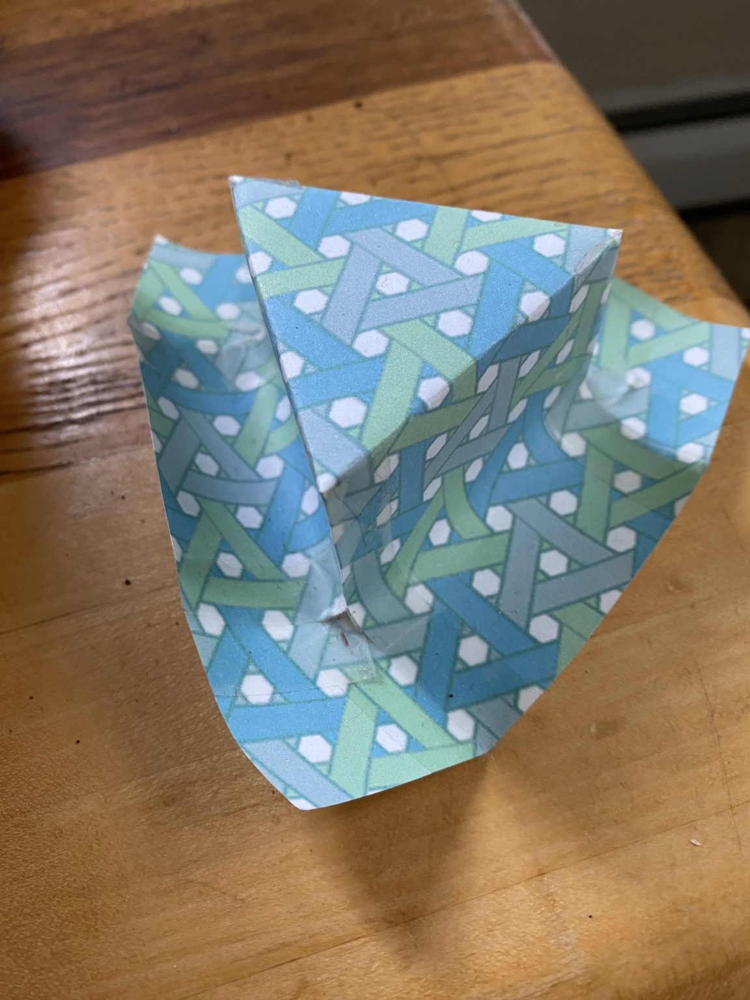

# Rendering approaches for a 3D MadWeave explorer

Research date: 2026-11-05. Branch: `research/multicorner-3d-explorer`, based on
`master` at `25fbd358828f19e26df859f7ea66766cfaf9561a`.
The repository calls its default branch `master`; it has no `main` branch.
The [Markdown review](MARKDOWN_REVIEW.md) covers all 40 tracked Markdown files
at that baseline, including later corrections to the early corner reports.

**Current direction: implement the construction in POV-Ray first, get it working
with Richard, then port that working construction into an existing browser
viewer.** Richard already knows POV-Ray; Blender is outside the recommended
workflow. The [existing-software follow-up](EXISTING_SOFTWARE.md) records the
revised plan, much smaller reuse estimates and a successful local model-viewer
probe in Chromium and Firefox.

The required views are now a **2D net with several chosen corners and angles**
and a **3D construction built from that net in POV-Ray**. The
[GPT-6 Astra advisory prompt](ASTRA_DESIGN_PROMPT.md) asks for a worked hat
construction and a concrete design for these two views.

**Current build: [triangular regular polyhedra](polyhedra/README.md)** in both
madweave and hexweave, starting with printed paper, fold lines and taped edges.
Richard explicitly chose these instead of another hat. The first set includes
tetrahedra, octahedra and icosahedra, aligned/skew offsets, and the octahedron's
threefold-center alternative. See the [printable booklet](polyhedra/example/all-nets.pdf).

The earlier [working hat](hat/README.md) has one connected paper net and
one outside cutting loop. Richard's original used a central piece reaching the
outer edges plus three wedges. The [construction priorities](BUILD_PRIORITIES.md)
record that distinction, ease of building, symmetry and the polyhedron scope.
The [triangular-lattice note](TRIANGULAR_LATTICE.md) records Richard's next
construction insight: varying both triangle size and orientation relative to
the grid gives many constructions of triangular-faced shapes.

The custom-renderer costs below are the earlier comparison, retained for
reference. They are not the current implementation budget. Reusing an existing
viewer can produce a basic display in 15–60 minutes once a compatible model is
available; a bounded picking/material adapter is estimated at 2–6 hours.

These are proposed approaches and effort estimates, not implemented features or
measured performance. Richard describes a direct
[cut-and-tape paper construction](PAPER_CONSTRUCTION.md): choose corners in
pattern openings, remove or insert angle, and tape the paper together. We will
develop its digital representation jointly. The estimates below cover rendering
supplied geometry; they do not assign a cost to that separate work.

## What the photograph suggests



The photograph suggests two useful representations: a folded paper surface
carrying a printed weave, and a network of individually modeled woven ribbons.
The first is enough to explore the overall shape. The second permits following
strips, inspecting underpasses, and eventually examining thickness and clearance.
Both should use the same supplied surface and material coordinates.

The raised triangular region, connecting panels and surrounding skirt are useful
visual targets. Exact dimensions, concealed joins, corner angles and fold topology
cannot be recovered from this view alone. A first example can be an explicitly
chosen approximation while we work out the construction together.

## Earlier comparison of four approaches

The four families below include alternatives within each family. Effort ranges
are estimates of my implementation and verification work, not vendor prices,
elapsed-time promises, or quotations from the sources. Their common scope and
exclusions are defined under [Cost assumptions](#cost-assumptions).

| Approach | How we would use it | Main advantage | Main cost or limitation | Rendering adapter effort |
| --- | --- | --- | --- | --- |
| 1. Browser engine: Three.js or Babylon.js | Upload supplied surface/ribbon meshes; orbit, select, recolor and inspect | Existing camera, material and picking machinery | Dependency and engine conventions; transparency still needs care | 12–24 hours for an initial Three.js viewer; 16–32 for Babylon.js |
| 2. Our own renderer | Write a small WebGL 2 or WebGPU rasterizer frontend; optionally a CPU reference renderer | Small, purpose-specific implementation under our control | We own camera math, GPU resources, picking and rendering regressions | 20–40 hours for WebGL 2; 24–48 for WebGPU, each as one backend |
| 3. POV-Ray scene generation | Export the same meshes and chosen camera to scene files | Familiar workflow, reproducible stills and turntables | An edit/render/view cycle rather than continuous manipulation | 8–20 hours for a repeatable export/render workflow |
| 4. Blender procedural scene | Generate meshes with Python; explore in EEVEE and render selected views | Strong desktop modeling, lighting and animation environment | Blender becomes a required authoring tool; browser controls remain separate | 12–28 hours for a scripted scene workflow |

These adapters are alternatives, so their estimates are not additive unless we
choose to build several. Browser engine versus custom renderer is primarily a
maintenance and feature choice; both can use the same GPU rasterization hardware.
Writing our own does not inherently make the triangles render faster.

## 1. Browser engine with custom MadWeave geometry

**Three.js:** use indexed `BufferGeometry` for panels and ribbons, with material
coordinates and identifiers alongside vertex data. Its raycaster returns face
indices and UV coordinates, allowing a hit to resolve to a local occurrence and
then a whole joined strip. Geometry buffers and picking are documented in the
[BufferGeometry](https://threejs.org/docs/pages/BufferGeometry.html) and
[Raycaster](https://threejs.org/docs/pages/Raycaster.html) references.

Start with its WebGL 2 renderer for the first comparison. Alternatively,
`WebGPURenderer` supports WebGPU with a WebGL 2 fallback. Its custom shader path
uses node materials/TSL, so shader code is not automatically interchangeable with
the older renderer. This is a backend choice to test, rather than an assumed
speed improvement. See the [WebGPU renderer guide](https://threejs.org/manual/pages/webgpurenderer).

**Babylon.js:** a credible substitute when built-in inspection, GUI, scene tools
and broader engine facilities are attractive. It offers WebGL/WebGPU, picking,
dynamic meshes and glTF export. Its Havok integration supplies rigid bodies and
constraints; it is not a ready-made woven-ribbon material solver. Our corner
assembly model would remain ours. See the [engine specifications](https://www.babylonjs.com/specifications/)
and [physics model](https://doc.babylonjs.com/features/featuresDeepDive/physics/rigidBodies).

For either engine, draw a printed-surface preview first and use actual ribbon
meshes for detailed inspection. Keep picking tied to model IDs when meshes are
batched. A generic triangle export can use glTF/GLB, but the editable MadWeave
model must also retain its own topology and identities. Three.js provides a
[glTF exporter](https://threejs.org/docs/pages/GLTFExporter.html).

## 2. Rendering it ourselves

There are several substantially different meanings of “our own renderer.”
Writing camera transforms and shaders on top of WebGL/WebGPU is much less work
than implementing all rasterization or light transport ourselves.

| Custom technique | What I would write | Small demonstration | More dependable initial version | Assessment for MadWeave |
| --- | --- | ---: | ---: | --- |
| Projected SVG or Canvas polygons | Camera projection, face drawing and visibility ordering | 3–6 hours | 16–40 hours within a restricted view/scene domain | Useful diagrams and wireframes; unrestricted woven occlusion complicates visibility |
| CPU rasterizer into Canvas | Triangle coverage, clipping, depth and ID buffers, shading, image upload | 6–12 hours | 24–60 hours | Useful independent reference or small-scene viewer; CPU fill cost grows with resolution |
| Raw WebGL 2 | GLSL shaders, buffers, camera, depth testing, picking and resource lifecycle | 6–12 hours | 20–40 hours | Best initial custom option for an opaque interactive explorer |
| Raw WebGPU | WGSL shaders, pipelines, bind groups, depth/ID targets and device lifecycle | 8–16 hours | 24–48 hours | Attractive if later GPU computation is valuable; detect adapter support explicitly |
| GPU ray/path tracer | Ray generation, intersections, BVH, lighting, accumulation and display | 20–40 hours | 80–160+ hours | A later rendering project; disproportionate for the first shape explorer |

The rightmost effort column includes the demonstration work; do not add those
columns. “Dependable initial” still means the bounded feature set below, not a
general game engine or a POV-Ray replacement.

### Projected vector drawing

We can project 3D points ourselves and draw filled polygons in the existing SVG
ecosystem, or in Canvas 2D. That is appealing for outlines, corner labels and
technical illustrations. Three.js also has an SVG renderer, whose documented
limitations include no textures, shadows or advanced shading.
[SVGRenderer reference](https://threejs.org/docs/pages/SVGRenderer.html).

My assessment: sorting entire strips or faces by average distance is insufficient
for general interlacing and intersecting surfaces. Correct vector visibility may
require splitting polygons and resolving their partial order for each view.
That can erase the apparent simplicity of this route. Use it for controlled
diagrams or overlays; use a depth buffer for unrestricted opaque orbiting.

### CPU software rasterization

A compact implementation would transform vertices into camera space, clip
triangles, project them, evaluate triangle edge functions, and keep the nearest
depth and material ID at each pixel. Texture coordinates require perspective
correct interpolation. We can send the resulting RGBA array to Canvas using
`putImageData`. This gives us an independently implemented visibility reference.
The algorithms are explained in the original [Scratchapixel rasterization lesson](https://www.scratchapixel.com/lessons/3d-basic-rendering/rasterization-practical-implementation/rasterization-practical-implementation.html);
the upload mechanism is documented by [Mozilla](https://developer.mozilla.org/en-US/docs/Web/API/CanvasRenderingContext2D/putImageData).

For scale, an implementation with one 4-byte color, 4-byte depth and 4-byte ID per
pixel needs **12 MB at one million pixels**, excluding meshes and temporary data.
Four candidate fragments per pixel at 30 frames/second mean roughly **120 million
fragment visits/second** at that resolution, before extra samples or textures.
These are arithmetic workload estimates, not a measured JavaScript frame rate.
A Worker can protect UI responsiveness; moving work to a Worker does not itself
remove the computation. WASM is a later optimization to measure if needed.

### Custom GPU rasterization

Here the GPU already provides triangle rasterization and a depth test. I would
write the small application-facing renderer: upload meshes, set transforms and
palette, run simple lighting shaders, and draw an ID pass for selection. WebGL
exposes [depth comparison](https://developer.mozilla.org/en-US/docs/Web/API/WebGLRenderingContext/depthFunc);
WebGPU explicitly defines [render pipelines and depth/stencil state](https://www.w3.org/TR/webgpu/#render-pipeline).

This suits a narrow application with a few materials, stable mesh buffers and
simple lighting. A tentative WebGL 2 work breakdown is:

| Work | Estimated hours |
| --- | ---: |
| Context, camera/projection math and orbit controls | 2–4 |
| Mesh upload, depth, normals and simple two-sided lighting | 2–4 |
| ID picking and mapping hits back to material | 2–4 |
| Incremental updates, resize, resource cleanup and PNG capture | 2–4 |
| Clipping, crossing, seam and picking regressions across browser engines | 6–12 |
| Integration fixes and documentation allowance | 4–12 |
| Total | 18–40; budget approximately 20–40 |

Translucent interwoven ribbons are a separate feature. A depth buffer alone
does not correctly composite all transparent layers; even Three.js documents
that object sorting cannot handle every case. Budget a further **12–32 hours**
for a bounded transparent rendering approach and its tests, with the exact
method selected after seeing representative meshes. Keep material opacity in
the model even if the first preview supports only opaque rendering, and label
that view limitation. See the [renderer sorting limitation](https://threejs.org/docs/pages/WebGLRenderer.html).

### Custom or existing GPU ray tracing

A path tracer could offer convincing light through gaps and softer shadows,
but needs more than casting one ray at every triangle. A BVH accelerates
intersection tests by rejecting groups of primitives; rebuilding/refitting it
becomes part of geometry-edit cost. Progressive accumulation must restart when
the camera or geometry changes. See the original [PBRT BVH implementation](https://www.pbr-book.org/4ed/Primitives_and_Intersection_Acceleration/Bounding_Volume_Hierarchies).

There is also a middle course: use an existing GPU path tracer with our meshes.
For example, the author's [three-gpu-pathtracer repository](https://github.com/gkjohnson/three-gpu-pathtracer)
documents a BVH-based GPU path-tracing implementation. This is worth evaluating
before writing our own. Its image quality, update cost and material handling on
our scenes would need testing. Neither a library nor custom GPU ray tracing
guarantees noiseless interactive renders on the user's hardware.

## 3. POV-Ray from the same geometry

Generate `mesh2` objects with indexed vertices, normals and per-face material
indices, together with a camera, lights and an INI file. Keep geometry in an
include file so camera and lighting experiments do not require regenerating the
weave. The official [mesh2 reference](https://wiki.povray.org/content/Reference:Mesh2)
provides these mesh attributes.

Use low-resolution, simple-light previews and reserve expensive lighting and
antialiasing settings for final images. POV-Ray 3.7 provides render quality
controls and multiple rendering workers, including `Work_Threads`/`+WT`.
Those controls can improve turnaround, but do not replace an interactive mesh
viewer. See [rendering options](https://www.povray.org/documentation/3.7.0/r3_2.html#r3_2_8).

This is a strong companion to either browser route: explore quickly, then export
the same snapshot for a deliberate render. Transfer the camera convention and
color-space settings explicitly. Matching geometry should be checked numerically;
different lighting and tone mapping need not produce identical pixels.

## 4. Blender as a procedural desktop explorer

Richard subsequently clarified that he knows POV-Ray and does not know Blender.
This option remains background research; the agreed workflow starts in POV-Ray.

Generate the supplied panel/ribbon meshes with Python, preserve IDs as custom
data, and expose a few meaningful scene parameters. Geometry Nodes can add
procedural display detail without becoming the authority for strip joins.
Blender documents Geometry Nodes as operations on meshes, curves and other
geometry types in its [introduction](https://docs.blender.org/manual/en/latest/modeling/geometry_nodes/introduction.html).

Use EEVEE for interactive lighting and shape inspection, and optionally Cycles
for selected final images. Blender describes EEVEE as its realtime rasterization
renderer and Cycles as a production ray-tracing renderer. See the
[EEVEE overview](https://docs.blender.org/manual/en/5.4/render/eevee/index.html)
and [rendering features](https://www.blender.org/features/rendering/).

This is attractive if desktop manipulation and animation matter more than
sharing a simple webpage. A browser explorer would still need its own controls.
Export evaluated triangle meshes for interchange; procedural node graphs are
not the portable editable MadWeave model. The [glTF manual](https://docs.blender.org/manual/en/dev/addons/scene_gltf2.html)
describes supported meshes, materials and custom properties.

## Shared model and the joint corner work

The renderer should consume a neutral geometry packet: vertices, triangle
indices, normals, optional material coordinates, palette/material assignments,
and a triangle-to-occurrence-to-strip map. The supplied surface may contain any
number of corners. Corner IDs, source paper pieces and taped-boundary pairings
travel with it. The starting construction model is Richard's
[patterned paper recipe](PAPER_CONSTRUCTION.md).

```text
Planar and corner reference data + jointly developed surface assembly
                              |
                    neutral geometry packet
                 /            |             \
       browser renderer    POV-Ray mesh2    Blender scene
                 |
          model ID selection
```

The existing work supplies important constraints for our joint geometry work:

- Preserve signed strip indices, complete clipped material, full-width joins,
  transported sides/faces, and distinct positions at self-crossings. Crossings
  never become material junctions. Painting targets the global strip.
- Keep reference coordinates, the existing distorted angular chart, and 3D
  embedding coordinates distinct. `f=360/beta` describes the current flat chart;
  it is not a fold angle. Positive and excess angle need different shape choices.
- Record how the retained paper and inserted pieces are taped together, carrying
  pattern registration and material identity across the paired boundaries.
  Work through concrete constructions with Richard. A fold changes a surface's
  embedding without necessarily introducing an intrinsic angular defect, so
  distinguish folds from corners made by removing or adding angle.
- Current seam-color conflicts remain visible warnings that retain chosen
  colors; opacity never removes material. Geometry/order failures remain
  separate from color diagnostics and rendering limitations.

These follow the [planar model](../PLANAR_MODEL.md),
[Stage 1 reference model](../SINGLE_CORNER_STAGE1.md),
[full-region crop model](../SINGLE_CORNER_CROP_FOLLOWUP.md), and current
[state contract](../CORNER_PROJECT_FORMAT.md). Reuse their evidence and relevant
helpers, rather than treating the present single-apex chart as a multi-corner
3D generator. The current catalogue certifies diagrams, not arbitrary embeddings.

For a detailed ribbon view, the geometry producer must supply actual crossing
separation and continuous ribbon geometry. The renderer cannot recover those
from SVG painter order. A coarse printed-surface preview can remain useful
while we develop that geometry together; it must identify its representation.

## Cost assumptions

All adapter estimates assume supplied, finite triangle meshes with normals,
material IDs and stable model-ID mappings. The bounded browser version includes
orbit/pan/zoom, simple lighting, opaque double-sided drawing, selection/highlight,
palette updates, resizing and PNG capture, with relevant browser regressions.
The POV-Ray and Blender estimates cover equivalent mesh/camera/material adapters
and their native viewing workflows, not browser controls inside those tools.

The estimates exclude deriving the multi-corner assembly, physical relaxation,
fabrication validation, a general topology editor, arbitrary model import,
full project-format integration, and exact arbitrary transparency. Those are
separate scopes. A working renderer demo is not a completed explorer.

The main uncertainty is testing and integration rather than writing the first
shader. The ranges are planning budgets with roughly factor-of-two uncertainty,
not a prediction of how long a single chat turn will take.

## Earlier proposed renderer comparison

The following comparison is deferred. The next construction work starts in
POV-Ray, following the [updated workflow](EXISTING_SOFTWARE.md), rather than
starting two competing browser viewers.

Use the same supplied mesh in a minimal Three.js viewer and a custom WebGL 2
viewer, then export that snapshot to POV-Ray. A proposed **12–24 hour total
comparison budget** covers two limited viewers, a basic exporter and evidence;
it is smaller in scope than the dependable adapters above, and its work can be
retained in the chosen implementation. Begin with an opaque synthetic weave
fixture so this comparison does not depend on solving corner assembly.

Measure geometry preparation separately from buffer upload, camera-only frame
time, selection latency and offline render time. Use 10k, 100k and 500k triangle
fixtures at 1280 by 720, with identical cameras and simple comparable lighting.
Record CPU/GPU, browser/backend, triangle and draw-call counts, memory and median
and 95th-percentile frame times. A target of 30 fps is 33.3 ms/frame; 60 fps is
16.7 ms/frame. Those are acceptance targets, not measured results.

Include near-plane clipping, grazing strip edges, holes, hidden material,
self-crossing IDs and deliberate wrong-depth/wrong-ID mutations. Shared-edge
cracks and depth fighting need explicit checks; the old SVG blend fix does not
automatically solve GPU mesh artifacts. Compare unlit material/ID output for
correctness before judging lit beauty renders. Test transparency separately.

Choose custom WebGL 2 if the limited feature set stays small and the results
justify owning the renderer. Choose Three.js if its existing facilities save
substantial implementation or maintenance effort. Keep the neutral model and
POV-Ray adapter whichever wins.

## Repository boundary

Keep this investigation under `research/multicorner-3d/` initially. Future code
can separate `core`, `viewer`, `exporters` and `fixtures` there, with no browser
engine types in the core. Use a distinct versioned 3D project format when there
is an agreed model; existing planar v1 and corner v1/v2/v3 files retain their
meaning, with explicit adapters if needed.

That boundary makes a later `madweave-3d` repository extraction straightforward
without requiring a new repository now. Preserve source provenance and the
project's existing rights statement when moving code. These research files and
the supplied photograph stay outside the site's publication allowlist.
