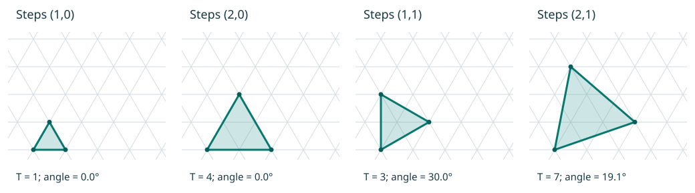

# Triangles of different sizes and orientations on the weave grid

Recorded from Richard's explanation, 2026-11-07. Branch:
`research/multicorner-3d-explorer`.

## Richard's construction insight

Richard says that shapes with triangular faces can be made in quite a few
different ways. On a regular triangular grid, triangles can be expanded and
also turned a little relative to the grid. He compares the way these choices
are indexed to a winding number. The explorer should preserve this family of
choices, rather than restrict faces to one orientation or one size.

The interpretation below concerns equilateral triangles, the immediate case
for tetrahedra, octahedra and icosahedra. It does not narrow Richard's broader
statement about triangular faces to regular solids.

## Repeating the offset preserves the pattern

Richard clarified that **whichever lattice direction/offset is chosen,
continuing to make triangles with that same kind of offset gives a
constructable result with the pattern preserved**. This is a construction rule
he supplies, stronger than our earlier description of isolated candidate
triangle placements.

Start at a chosen opening, choose an edge offset on the underlying grid, and
continue the triangular layout using that offset and its triangular-grid
rotations. The triangles share a consistent relationship to the original
pattern. The offset is a repeatable rule for the construction, not a separate
arbitrary orientation chosen independently for each face.

The explorer should therefore generate adjoining triangles by propagating the
chosen offset. Carry the original paper's pattern coordinates through this
layout and into the folded model. Record a particular color assignment
separately from preservation of the underlying weave pattern.

## Working interpretation: a pair of lattice steps

Take equal-length grid vectors `e1` and `e2` at 60 degrees, with length `a`.
Choose integers `(m,n)` and make an edge

```text
v = m e1 + n e2
```

The other edge from the same corner is its 60-degree rotation. In lattice
coordinates that rotation sends `(m,n)` to `(-n,m+n)`, so the three vertices are

```text
p,  p + m e1 + n e2,  p - n e1 + (m+n) e2.
```

This gives an equilateral triangle with

```text
side length = a sqrt(m² + mn + n²)
orientation = atan2(sqrt(3) n, 2m+n)
area / elementary grid-triangle area = T = m² + mn + n².
```



| Steps `(m,n)` | Side length / a | Orientation |
| --- | ---: | ---: |
| (1,0) | 1 | 0° |
| (2,0) | 2 | 0° |
| (1,1) | sqrt(3) | 30° |
| (2,1) | sqrt(7) | approximately 19.1° |

Multiplying both integers by the same positive integer enlarges the triangle
without changing its orientation. Changing their ratio changes the orientation
relative to the fixed weave. Reflected placements should also be available;
they may differ in the woven construction even when the solid has the same
shape. This rotation is a placement on the paper, not physical torsion of a
ribbon or a change in the assembled corner angle.

The closely related `(h,k)` indexing occurs in Goldberg–Coxeter and
Caspar–Klug constructions. Schein and Gayed's
[2014 primary paper, introduction and Figure 1](https://pmc.ncbi.nlm.nih.gov/articles/PMC3939887/)
describes equilateral triangles of different sizes and orientations over a
hexagonal tiling, indexed by two steps at 60 degrees, with
`T = h² + hk + k²`. This is a useful identification to discuss with Richard,
not a claim that we have established the precise term he intended. Here `T`
is a geometric area ratio; a turned triangle's boundary can cut elementary
grid triangles. It need not be a union of exactly T whole grid cells.

For madweave specifically, Paul Gailiunas's
[A Mad Weave Tetrahedron (2011), section “Skew Weaving”](https://archive.bridgesmathart.org/2011/bridges2011-39.pdf)
and [Patterns for Skew Mad Weave Polyhedra (2013)](https://archive.bridgesmathart.org/2013/bridges2013-13.pdf)
are direct references for strands skew to faces and the effects of placement
on symmetry and coloring.

## Consequences for the explorer

- Store face size and orientation through lattice coordinates, plus an origin
  and the chosen opening type/phase. Do not replace all choices by a single
  face-side-length slider.
- Establish which opening lattice the vectors refer to. Its spacing `a` need
  not equal the existing strip pitch `P`, and the two kinds of opening may
  require different placement rules.
- Keep the pattern fixed while comparing these triangles in the 2D view;
  otherwise the relative rotation disappears from the illustration.
- Apply the selected placement to the paper/net and carry its pattern
  coordinates through to POV-Ray. Rotating the camera does not express this
  choice.
- Generate the adjoining triangular layout by repeating the chosen offset and
  its grid rotations, following Richard's pattern-preserving construction rule.
- Check joined edge lengths, opening centers, pattern phase and over/under
  order to verify that our implementation follows that rule. These checks
  validate the software, rather than treating each repeated-offset construction
  as an unestablished possibility. Evaluate any requested color behavior
  separately.

This is recorded understanding and a proposed parameterization. No new
polyhedron recipe or general lattice-selection control is implemented here.
Keep the easy triangular-face examples first; the dodecahedron remains deferred.
