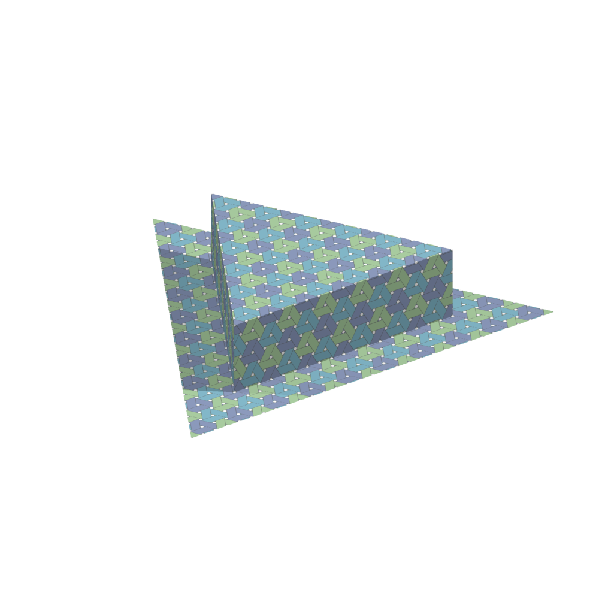
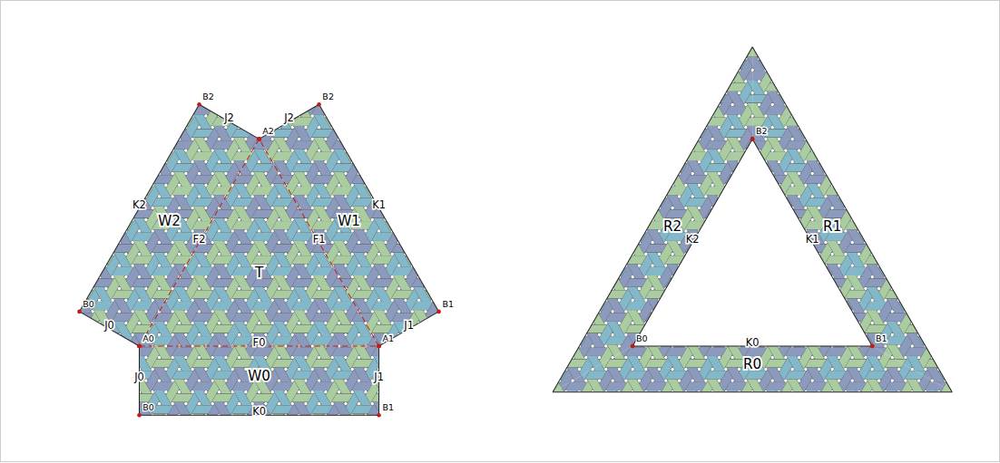
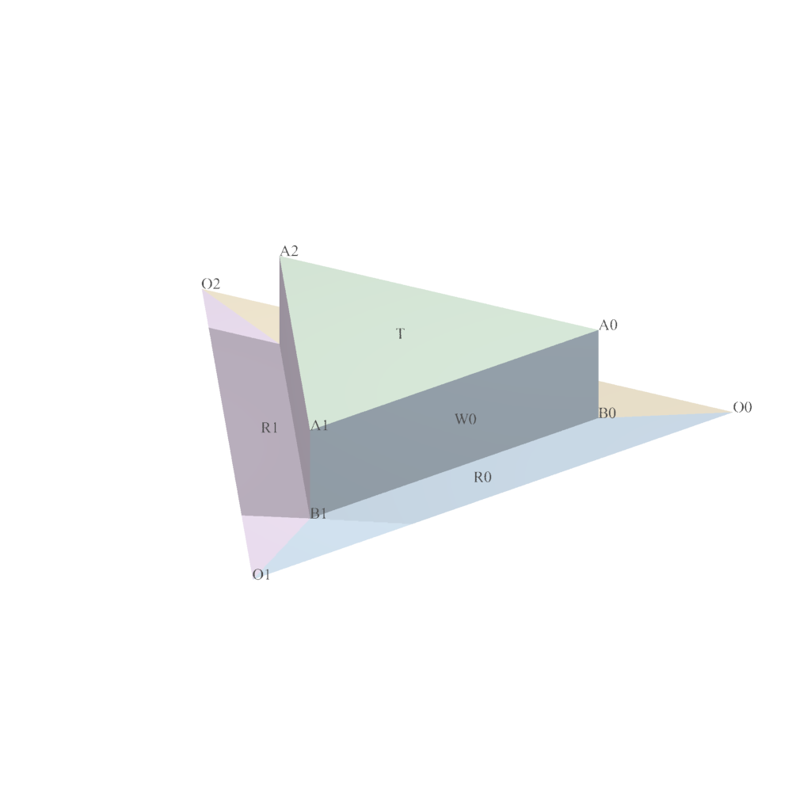

# First working paper hat

The same seven reference regions now produce a patterned two-sheet net and
POV-Ray renders. This is the first implementation of the
[accepted hat proposal](../ASTRA_DESIGN_ADVICE.md), after Richard authorized
proceeding beyond the advisory task. It is a construction recipe, not yet a
corner-selection UI or a general polyhedron editor.



The top is a triangle with three rectangular walls. The surrounding brim is a
second printed sheet with a triangular hole. The preview uses paper with the
same print visible on both sides. Its strips are printed artwork, not separate
raised ribbons. The ideal surface has no thickness.



Solid lines are cut edges; dashed red lines are retained folds F0–F2. Tape
matching J labels to close the walls, then matching K labels to attach the brim.
Repeated A/B labels identify paper occurrences of the same assembled corner.
R0–R2 divide the brim for calculations only: their shared edges are not cuts.
The saved SVG uses one pitch = 6 mm at 100% print scale. Its complete layout is
larger than A4; it has no tape tabs or page-tiling preparation yet. The geometry
can be inspected as paper dimensions, but no physical build is claimed.



A0–A2 have 240° of incident paper each; B0–B2 have 480°. Hidden labels can be
occluded in this ordinary depth-tested view. The construction record preserves
all local occurrences, including ones not visible from the current camera.

## Open the local preview

From the repository root, run:

```sh
python3 -m http.server 8004 --bind 127.0.0.1
```

Then open <http://127.0.0.1:8004/research/output/multicorner-hat/>.
The page includes the net, three-quarter, top, side, underside, reverse and
plain labeled views. It is already generated in this checkout. It also opens
as a local `index.html` file. Camera views are rendered images, not interactive
orbit controls. Research artifacts are outside the production site's allowlist.

## Reproduce or change the example

Use the repository's installed Playwright/Chromium and Python 3. The tests use
Pillow. POV-Ray 3.7.0.10 at `/usr/bin/povray` was used here; the unrelated binary
at `/usr/local/bin/povray` currently fails to load a shared library, so these
commands choose the working system binary explicitly.

```sh
PLAYWRIGHT_BROWSERS_PATH=/tmp/madweave-browsers \
  node research/multicorner-3d/hat/capture-pattern.cjs
python3 research/multicorner-3d/hat/build.py --render --povray /usr/bin/povray
python3 -m unittest discover -s research/multicorner-3d/hat -p 'test_*.py' -v
```

The capture uses the original `madweave.js` engine: P=1, W=.75, C/hand/X off,
three class colors, opaque ink and strip-edge lines. A larger finite strip set
covers the reference rectangle [-9,31]². Its array offset differs from the
fixed signed-index offset by 45, preserving class and order phase. No new weave
renderer was written. The PNG is 2000 × 2000, at 50 pixels per pitch; generated
SVG artwork is also retained in the ignored output directory.

The builder defaults to side `12 sqrt(3)` pitches, height 6 pitches, brim width
4 pitches. For a smaller example, use `--side-units 6`. `--height` accepts positive
multiples of 6 pitches, `--side-units` positive multiples of 6, and `--brim` any
positive width. The finite captured print bounds are checked: a larger requested
shape is rejected rather than stretched or filled with missing artwork.
`--size` controls render resolution. More flexible dimensions and automatic
print extents are subsequent work; these restrictions describe this recipe,
not a restriction on all future constructions.

`build.py` owns the recipe's paper coordinates, seven named panels, six corner
sites and edge pairings. Both the SVG and scene are generated from those records.
`construction.json` retains reference and assembled positions, sheet identities,
corner occurrence names, join types and pattern mapping. This is a working
record for the example, not a promised general file format. Camera and light
choices are separate from the geometry. The original application is untouched.

The generated [working scene](example/hat.pov), [print](example/pattern.png),
[construction record](example/construction.json) and [checks](example/checks.json)
are retained as a directly usable snapshot. To render without Python or Node:

```sh
cd research/multicorner-3d/hat/example
/usr/bin/povray +Ihat.pov +O/tmp/madweave-hat.png +W1000 +H1000 -D +A0.15 Declare=View=0
```

Views 0–4 are three-quarter/top/side/underside/reverse. `Declare=Plain=1` displays
panel colors and labels. The scene uses POV-Ray's documented
[mesh2 UV mapping](https://www.povray.org/documentation/view/3.7.0/68/): UVs come
from paper coordinates, not world-space projection or separately fitted panel
images. Back-side print and zero thickness are explicit first-preview choices.

## Checks actually run

- Five Python tests pass, including a smaller recipe and rejection of a moved
  wall vertex, a wrong corner angle and an unsupported height phase.
- 105 intra-panel distance comparisons show that placements preserve reference
  lengths. All 12 edge pairs close: six taped pairs, three folds and three
  coplanar brim subdivisions.
- Incident polygon angles reproduce all six beta values. The brim area equals
  the outer triangle minus the inner triangle. Its constituent trapezoids have
  explicitly matching radial boundaries.
- The oriented triangulation has nine vertices, 21 edges and 13 triangles,
  Euler characteristic 1, opposite interior edge orientations and only the three
  outer brim edges unpaired. No bottom face fills the brim's inner opening.
- 630 safe-interior pixel comparisons on the actual captured print agree across
  all six taped joins within three RGB levels. Samples exclude strip/outline
  antialiasing boundaries, and require multiple colors so a blank image cannot
  pass. The advisory rotation/translation proof supplies the continuous geometry
  and order argument; these sampled pixels corroborate the captured artwork.
- All six POV-Ray jobs completed successfully. The patterned, underside and
  labeled views were visually inspected. The local page decoded all seven
  images with no JavaScript errors or horizontal overflow at widths 1280 and
  390 in Chromium responsive emulation.

This does not certify individual ribbon components, finite-thickness weaving,
mechanical stability, arbitrary net edits or every seam pixel. The next useful
extension is selection and editing of the shared region/join records, followed
by a second recipe or a faces-first polyhedron. Those should reuse the current
outputs, not turn the hat into the application's universal shape model.
