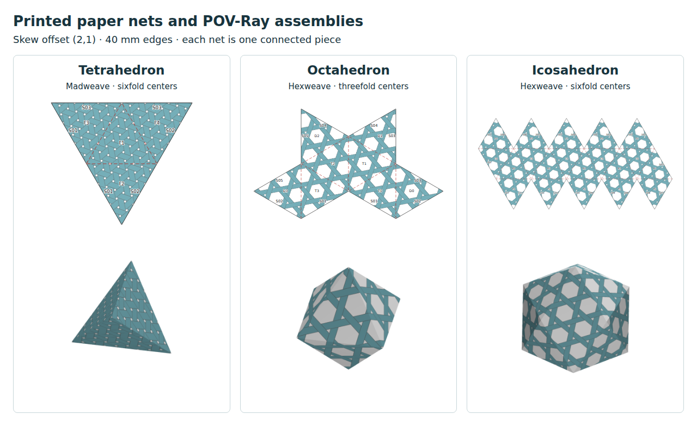

# Printed paper tetrahedron, octahedron and icosahedron

Richard's next build is **regular polyhedra with triangular faces, using both
madweave and hexweave printed on paper, with folds and taped joins**. Do not
build another hat as the next example. Include different lattice offsets.
Recorded and implemented on `research/multicorner-3d-explorer`, 2026-11-07.

Open the [16-page printable booklet](example/all-nets.pdf), or the generated
[local gallery](../../output/triangular-polyhedra/index.html). The gallery has
individual PDF/SVG nets, assembled POV-Ray previews and construction records.
The printed strips are artwork on paper; the white hexweave openings remain
paper. Do not cut out the individual pattern openings.

A convenient first threefold-center build is this
[skew hexweave octahedron PDF](example/octahedron-hexweave-2-1-threefold/net.pdf)
(also page 12 of the complete default booklet).



## Which centers work?

| Solid | Triangle faces | Faces at each vertex | Incident angle | Sixfold centers | Threefold centers |
| --- | ---: | ---: | ---: | --- | --- |
| Tetrahedron | 4 | 3 | 180° | Yes | Use sixfold |
| Octahedron | 8 | 4 | 240° | Yes | Yes |
| Icosahedron | 20 | 5 | 300° | Yes | Use sixfold |

Threefold centers supply 120° sectors: the octahedron uses two at a vertex.
Sixfold centers supply 60° sectors and support all three incident angles.
This describes the pattern-preserving corner family used here, not an
impossibility theorem for every alternative weaving method. For madweave both
center types are small hexagonal openings distinguished by over/under phase;
for hexweave the sixfold centers are large hexagons and the threefold centers
are small triangular openings. The print uses the -y triangular orientation.
These follow the repository's [corner catalogue](../../SINGLE_CORNER_STAGE1.md).

The default booklet has 16 alternatives: both weave patterns and both offsets
for each solid, plus the octahedron's threefold-center versions in both patterns
and both offsets. Choose a page; it is one complete solid, not a piece to combine
with other booklet pages.

## Cutting and assembly

Every net is **one connected piece**, with one outside cutting loop, no enclosed
cut holes and no positive-area overlap. The default edge length is 40 mm. All
pages fit landscape US Letter or A4 at actual size; the saved PDF uses Letter.
Print at 100%, without fitting/shrinking the page. Check the 40 mm calibration
line before cutting. This is the first paper-build version; no physical assembly
has yet been reported.

1. Cut the solid black outside outline. The repeated S labels identify pairs
   of edges to tape, not extra pieces to cut out.
2. Score the dashed red lines lightly and fold away from the patterned side,
   so the printed pattern is outside the convex solid.
3. Match identical S labels and tape from inside. There are no glue tabs.
   Keep the final join accessible and close it last.

| Solid | Retained folds | Tape pairs | Net arrangement |
| --- | ---: | ---: | --- |
| Tetrahedron | 3 | 3 | Central triangle with three attached triangles |
| Octahedron | 7 | 5 | Four top triangles in a fan, each with a bottom triangle attached |
| Icosahedron | 19 | 11 | Ten-triangle belt, with five top and five bottom triangles attached |

For the tetrahedron, fold the three flaps around the central face. For the
octahedron, bring the four T faces around the north vertex, then close the D
faces around the south vertex. For the icosahedron, close the B/C belt, then
close the T and D caps. Match the printed S labels throughout. These are
suggested assembly orders to try with Richard, rather than a physically tested
taping sequence.

## Offsets and pattern registration

The first choices are aligned `(3,0)` and skew `(2,1)`. These are the
[two-integer lattice indices](../TRIANGULAR_LATTICE.md) Richard compared to a
winding number. The construction is commonly described as **skew weaving**;
the related Goldberg–Coxeter indexing uses `(h,k)`.

For these first recipes the opening-lattice basis, in strip pitches, is

```text
e1 = (2 sqrt(3), 0)
e2 = (sqrt(3), 3)
edge = m e1 + n e2
```

This basis preserves the selected opening kind and pattern phase. It is a
convenient repeat lattice, not a claim to enumerate every smaller usable
offset. Each net repeats its chosen edge and its 60° rotations, following
Richard's construction rule. Increasing a pair scales it; changing the ratio
turns the faces relative to the weave. `(2,1)` has about 19.1° relative rotation.
The two default alternatives have equal 40 mm physical edges, so their printed
strip pitches differ (approximately 3.85 and 4.36 mm).

The whole paper net, including its pattern, is rotated to fit the page. This
does not change the weave's orientation relative to the faces. The original
paper coordinates are retained for both the SVG print and POV-Ray texture.

The captured pattern comes from **the existing `madweave.js` renderer**:
madweave uses C=1 and all a/b/c classes; hexweave uses C=0 and only b. Both have
a sixfold opening at the origin, with hand=X=off. The threefold origins are
`(1/sqrt(3),1)` for madweave and `(sqrt(3),1)` for hexweave. Keeping these phase
choices separate matters: C=1 hexweave-b does not have a large hexagonal opening
at the origin. Both use width/pitch=.75 and opaque teal ink with visible strip
edges. A single ink keeps this first set focused on the weave and its folds;
multicolor strip assignments can follow.

The nets assemble the same captured PNG tile used by POV-Ray into one image
over the paper domain, at approximately 370–420 dpi for the default prints;
cut lines, folds and labels remain vector elements. Exact tile periods avoid
accumulating registration error. This avoids Chromium's PDF tessellation of
repeating bitmap/SVG patterns, which produced jagged output. The source SVG
capture is also retained in the generated pattern directory.

## Reproduce or choose another offset

From the repository root, with Python 3, Pillow, the root Node dependencies,
Playwright Chromium, system POV-Ray, and Poppler's `pdfinfo`/`pdftotext`:

```sh
PLAYWRIGHT_BROWSERS_PATH=/tmp/madweave-browsers \
  node research/multicorner-3d/polyhedra/capture-patterns.cjs
python3 research/multicorner-3d/polyhedra/build.py --render
python3 -m unittest discover -s research/multicorner-3d/polyhedra -p 'test_*.py' -v
PLAYWRIGHT_BROWSERS_PATH=/tmp/madweave-browsers \
  node research/multicorner-3d/polyhedra/print-nets.cjs
```

The browser path is the one available in this checkout; omit it when using a
standard Playwright browser installation. The builder chooses `/usr/bin/povray`.
Pass `--povray` for another installation; the unrelated `/usr/local/bin/povray`
in this environment does not currently load its shared library.

For example, to build only skew threefold hexweave octahedra:

```sh
python3 research/multicorner-3d/polyhedra/build.py \
  --solid octahedron --weave hexweave --center threefold --offset 1 2 --render
```

`--offset M N`, `--solid`, and `--weave` can be repeated. With no arguments the
builder produces the 16 alternatives above. `--center` restricts the center
family; threefold defaults to the octahedron. `--edge-mm` changes physical edge
size, with an explicit rejection if the net will not fit the supported single
sheet. The gallery/manifest/booklet describe the latest selection; earlier case
directories may remain in the ignored output directory. Run the default command
again to restore the complete set. Use `print-nets.cjs --a4` for A4 PDFs.

Generated files are in `research/output/triangular-polyhedra`. For HTTP viewing,
run `python3 -m http.server 8004 --bind 127.0.0.1` from the root and open
<http://127.0.0.1:8004/research/output/triangular-polyhedra/>.

## Checks and limits

The checks cover regular unit-edge solids and their isometric unfoldings,
paired and oriented closed edges, sphere Euler characteristic 2, vertex angle
sums, retained-fold connectivity, nonoverlapping lattice triangles and a single
simple cutting loop. They verify every join is a rotation in the chosen center
family followed by a phase-preserving translation. Rejection tests exercise
damaged geometry, missing joins, disconnected folds, wrong corner angles and
invalid dimensions/offsets.

The eight tests pass. Across the 16 default models, **83,553 stable pixel pairs**
agree across the joins in the actual captured pattern. Separate tile/reference
comparisons pass for 2,874 madweave and 3,157 hexweave samples. Every corner
samples an opening. Browser checks verify one PDF page per alternative, 16
booklet pages, all 32 gallery images decoded, scale text on every page and no
horizontal overflow at 1200 and 390 px. POV-Ray renders all 16 assembled models.
These are software/print checks, not evidence of a completed physical build.

The `example/` snapshot retains the complete PDF booklet, manifest and browser
check results, plus individual PDFs, scenes, textures and geometry/check records
for the three models shown in the overview. Each saved scene renders directly
from its directory with `/usr/bin/povray +Isolid.pov +Oassembled.png +W700 +H700 -D`.

The assembled previews use ideal paper faces of zero thickness. They supply a
shared construction for the two views without ribbon thickness, paper mechanics
or an interactive unfolding animation. The production editor is unchanged.

Paul Gailiunas's [2011 paper](https://archive.bridgesmathart.org/2011/bridges2011-39.pdf)
and [2013 paper](https://archive.bridgesmathart.org/2013/bridges2013-13.pdf) provide
construction references for triangular-faced woven polyhedra and skew weaving.
These prints implement our explicit paper recipes and the repository's corner
model. Further offset/color choices and physical ease of folding remain work
to develop with Richard. The dodecahedron remains deferred.
